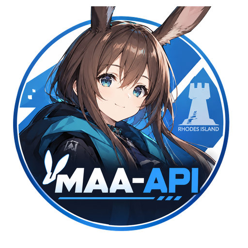

<p align="center">
  
</p>

# MAA-API

以 MaaAssistantArknights 为内核的 FastAPI 服务，自带 Web 控制台、开放 API 与内置 Agent。
重构方案与决策见 [docs/](docs/README.md)。

> 非官方粉丝作品：《明日方舟》角色与相关素材版权归 Hypergryph / Studio Montagne 所有，本项目与鹰角网络无隶属关系。

## Copilot 作业

通过 Agent 的 `upload_copilot` 保存并校验作业 JSON，再把返回的资产 ID 作为 `Copilot` 任务提交到流水线或定时任务。每次执行都会从已校验的资产生成独立私有快照；MaaCore 读取这份快照，源文件在解析后被修改或删除不影响当前运行。资源路径任一组件是 symlink 时会拒绝执行，快照在流水线结束后清理。Copilot 使用自己的任务类型，不会被替换成普通 Fight 关卡。

## 内置 Agent

`/agent` 支持自然语言对话、流水线和定时任务编排、日志分析、自动故障诊断与安全恢复。默认模型为 DeepSeek Flash（`deepseek-flash`，`https://api.deepseek.com`）；base URL、API Key 和模型可在设置页修改。`api.deepseek.com` 目前只接受 `deepseek-flash` 与 `deepseek-v4-pro`，模型标识写错会被上游以 400 拒绝。数据库中保存的 API Key 由 `MAA_LLM_ENCRYPTION_KEY` Fernet 主密钥加密，因此要使用设置页保存 LLM 密钥时必须配置并持久保管该环境变量。流水线与 schedule 编辑器可从已保存资源中选择 Copilot 作业。

## Docker 镜像

镜像构建会自动执行 Vite 前端构建，再把产物复制到 Python 运行镜像：

```bash
sudo docker build -t maa-api .
```

启动容器时仅挂载持久化运行数据目录。不要把整个仓库挂载到 `/app`，否则会遮住镜像内的 `static/` 前端产物与应用代码：

```bash
mkdir -p resource
sudo docker run -d -p 8002:8002 --name maa-api \
  -v "$(pwd)/resource:/app/resource" \
  --network host \
  --restart unless-stopped \
  -e TZ=Asia/Shanghai \
  -e MAA_APP_ACCESS_TOKEN="替换为自己的访问令牌" \
  -e MAA_LLM_ENCRYPTION_KEY="设置页加密 API Key 用的稳定主密钥" \
  maa-api
```

镜像从 `config.template.yaml` 创建默认 `/app/config.yaml`。可用 `MAA_APP_ACCESS_TOKEN` 设置 API 访问令牌；配置 `MAA_LLM_ENCRYPTION_KEY` 后可在设置页加密保存 DeepSeek API Key。更换该主密钥会导致旧数据库密钥无法解密；运行数据与 MaaCore 下载内容保存在挂载的 `resource/` 中。

## 裸机启动

第一次启动后端前先生成静态前端产物：

```bash
cd web && pnpm install --frozen-lockfile && pnpm build
cd ..
poetry run uvicorn maa_api.main:app --host 0.0.0.0 --port 8002
```

## macOS 开机自启（LaunchAgent）

用 launchd 让服务常驻：登录即起、进程退出即被拉起。管理命令都在 [maa-api-service.sh](scripts/maa-api-service.sh)：

```bash
./scripts/maa-api-service.sh install      # 安装并启动（可反复执行，用于更新配置）
./scripts/maa-api-service.sh status       # 加载状态、PID、端口监听、日志位置
./scripts/maa-api-service.sh logs 80      # 看应用日志与启动期兜底日志
./scripts/maa-api-service.sh logs -f      # 持续跟随
./scripts/maa-api-service.sh reload       # 改了 config.yaml 之后重启生效
./scripts/maa-api-service.sh stop         # 停止当前实例
./scripts/maa-api-service.sh disable      # 真正停用：停止且不再被拉起
```

| 命令 | 作用 |
|---|---|
| `install` | 渲染模板 → 校验语法 → 安装到 `~/Library/LaunchAgents/` → 启动 |
| `uninstall` | 停止并删除 LaunchAgent（`--purge-logs` 顺带删除兜底日志） |
| `start` / `stop` | 加载并启动 / 停止并卸载；`stop` 后 KeepAlive 仍启用 |
| `restart` / `reload` | 重启服务，等价于 `launchctl kickstart -k` |
| `enable` / `disable` | 允许 / 禁止自启并立即停止 |
| `status` / `logs` / `paths` / `check` | 看状态、看日志、打印路径、只体检不改状态 |

- plist 的唯一事实来源是 [local.maa-api.plist.template](scripts/launchd/local.maa-api.plist.template)：不要直接编辑 `~/Library/LaunchAgents/local.maa-api.plist`，改模板后重新 `install`。
- `stop` 不等于停服：KeepAlive 会把它拉回来，要彻底停用请用 `disable`（这也是它的设计语义：常驻）。
- 改 `config.yaml` 后必须 `reload`，launchd 起的实例没有终端可 Ctrl-C。
- 日志分两处：应用日志在 `resource/log/YYYY-MM-DD.log`；`resource/log/uvicorn.err` 只在「Python 还没起来就死」时才有内容（venv 被删、`config.yaml` 语法错）。脚本每次启动前会把后者截到最后 2MB。
- 换端口：`MAA_PORT=<端口> ./scripts/maa-api-service.sh install`，同时要保证 [start-maa-api.sh](scripts/start-maa-api.sh) 拿到同一个 `MAA_PORT`（模板已把它写进 plist 的环境变量）。
- launchd 只存在于 macOS。Linux 用 systemd，容器用 `--restart unless-stopped`（见上一节），不要与 LaunchAgent 同时跑：两者会抢同一个 8002 端口与同一个 SQLite 库。

## 手机与 PWA

手机可通过同一网络访问主机地址。若要启用 Service Worker、离线外壳与 Chromium 安装提示，请通过 Tailscale Serve 的 HTTPS 地址访问；直接使用局域网 HTTP 仍可打开页面和调用 API，但浏览器会禁用这些安全上下文能力。iOS 仍可从 Safari 分享菜单手动添加到主屏幕。Web Push 已接入（M14），需要 HTTPS 入口与 VAPID 密钥。

## 用 superpowers 推进里程碑

后续里程碑（范围见 [docs/12](docs/12-实施计划与里程碑.md)）在 Codex 中用 superpowers 插件推进。项目约定写在 [AGENTS.md](AGENTS.md)，下面的提示词只需把 `<N>` 换成里程碑编号。

### 第一步：在计划模式里理清范围

```text
/plan 使用 superpowers 开发执行方案中的 M<N>。规格以 docs/12 的 M<N> 一节及其引用的专题文档为准，已定决策见 docs/README.md 与 docs/13（含 §8）；只问文档没覆盖、互相冲突或需要先实测的地方。最后给我一份一页的 M<N> 简报：范围与非目标、硬约束、需要先验证的假设、硬验收命令、需要真机的补充检查。
```

回答它的问题，确认简报后进入下一步。

### 第二步：设为目标，让它执行到底

```text
/goal 按计划模式里确认的 M<N> 简报完成 M<N>：先把简报写成 spec 并提交（视为已批准，不用再等我审），再用 writing-plans 写计划（不需要我审，执行方式用 subagent-driven），然后执行。收尾按 AGENTS.md 直接本地合并并打 v2-m<N> tag，不用问我合并方式；涉及前端时，前端验收至少在干净克隆上跑一次。只有 AGENTS.md 规定要问我的情况才停下。
```

它只会在 AGENTS.md 规定必须问你的地方暂停。结束后读它的报告：验收结果、替你做过的裁决、推迟处理的问题。

### 大里程碑：换新会话执行

M11、M13 这类大里程碑，确认简报后先在普通模式里说"把刚才确认的简报写成 spec，再写计划，都提交后停下"，然后新开一个会话执行，让主控从干净的上下文开始：

```text
/goal 用 subagent-driven-development 执行 docs/superpowers/plans/<计划文件>.md，完成后按 AGENTS.md 收尾，不用问我合并方式；涉及前端时，前端验收至少在干净克隆上跑一次。
```

执行中断或会话过长时，新开一个会话接着做：

```text
继续用 subagent-driven-development 执行 docs/superpowers/plans/<计划文件>.md。先读它的台账和 git log，从第一个未完成的任务接着做。
```
