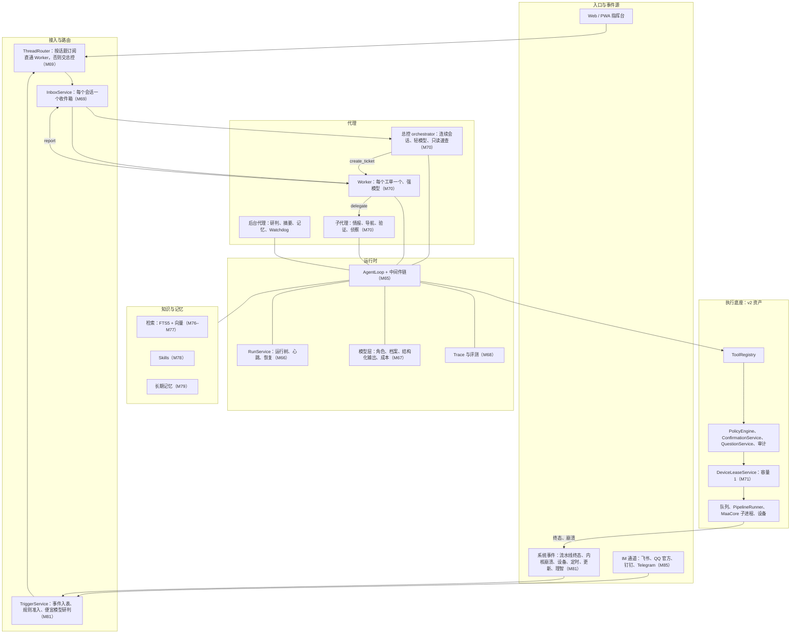
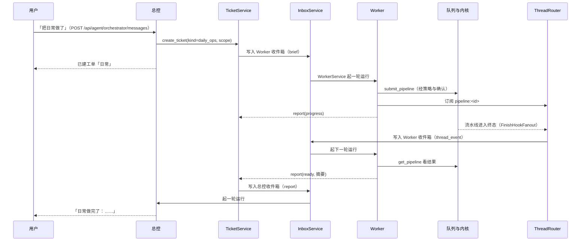
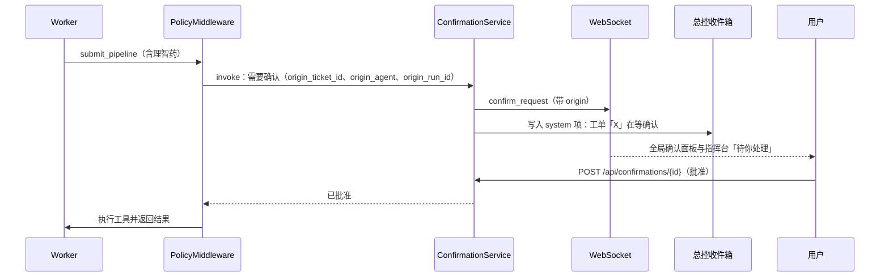
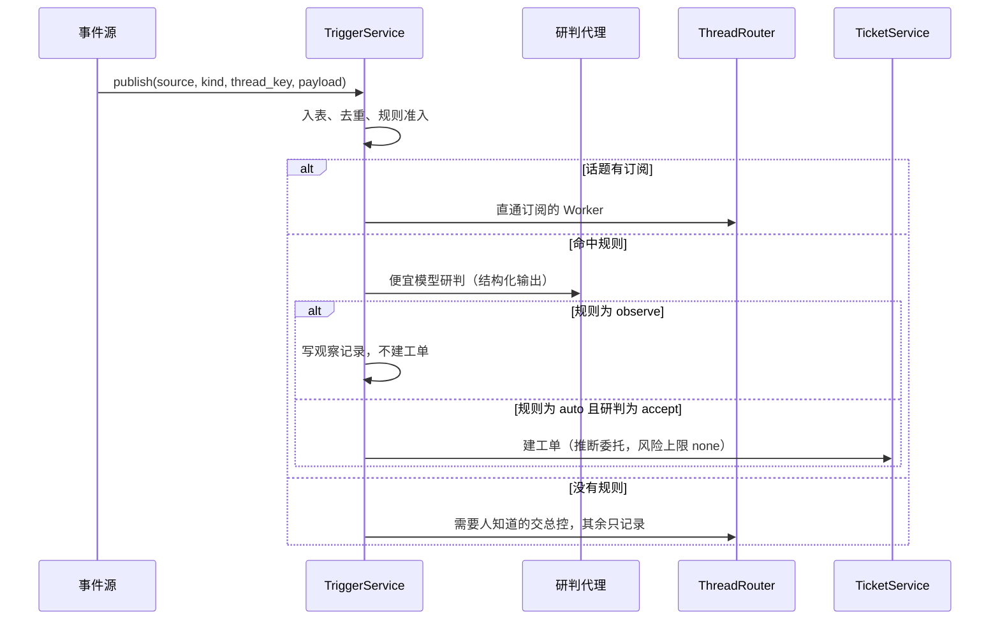

# 02 系统架构

本文定义 v3 的组件、并发模型、模块布局与关键时序。表结构见 [03](./03-数据模型.md)，接口与事件见 [04](./04-接口与事件协议.md)，运行时细节见 [05](./05-运行时与代理定义.md)。

## 1. 总图



## 2. 组件职责

### 2.1 代理

| 代理 | 种类 | 职责 | 不做什么 |
|---|---|---|---|
| 总控 | orchestrator | 接住所有入口的人类消息；判断是直接回答还是建工单；转述 Worker 的汇报；替 Worker 向用户提问；管理工单（列、查、取消） | 不持有设备租约；不调用写设备或消耗类工具（`stop_pipeline` 除外）；不做多步研究 |
| Worker | worker | 在一个工单的委托范围内完成工作；按需委派子代理；每轮以 `report` 收尾 | 不直接给用户发消息（只有汇报与确认、提问）；不超出委托 |
| 子代理 | subagent | 完成 Worker 交给的一段任务，只回传结构化结论 | 不再委派（深度上限 2）；不写工单 |
| 后台代理 | background | 事件研判（M81）、摘要压缩（M74）、记忆整理（M79）、Watchdog（M83）、标题生成 | 没有用户会话；除 Watchdog 外不调用工具 |

内置代理名单与工具集见 [05 §3](./05-运行时与代理定义.md)。

### 2.2 服务

| 服务 | 模块 | 里程碑 | 职责 |
|---|---|---|---|
| `AgentSpecRegistry` | `maa_api/agent/specs/registry.py` | M65 | 加载、校验内置代理定义，算版本哈希 |
| `AgentLoop` | `maa_api/agent/harness/loop.py` | M65 | 一次运行的「模型 → 工具 → 模型」循环，挂中间件链 |
| `RunService` | `maa_api/agent/runs/service.py` | M66 | 建运行、心跳、结束、按树查询；会话级「至多一个活动运行」 |
| `RunRecovery` | `maa_api/agent/runs/recovery.py` | M66 | 启动时把上一进程遗留的运行标为中断并写恢复提示 |
| `ModelRouter` | `maa_api/agent/llm/roles.py` | M67 | 按角色解析模型档案并构造客户端 |
| `CostLedger` | `maa_api/agent/llm/cost.py` | M67 | 每次调用写成本账本，累计到运行 |
| `SpanRecorder` | `maa_api/agent/trace/spans.py` | M68 | 记录 span，按运行组织 |
| `TraceSpanRepository` | `maa_api/db/repositories/trace.py` | M68 | 批量写、按 trace 查询、按保留天数清理 |
| `OtlpExporter`、`build_exporter` | `maa_api/agent/trace/otlp.py` | M68 | 装了 `otlp` extra 且配了端点时把 span 导出到 Langfuse 或 Phoenix |
| `TicketService` | `maa_api/agent/tickets/service.py` | M69 | 建单（连同委托）、状态机、结束、查询 |
| `ThreadRouter` | `maa_api/agent/tickets/threads.py` | M69 | 话题订阅；把话题事件写进订阅工单的收件箱，没有订阅的交总控 |
| `TicketPushNotifier` | `maa_api/agent/tickets/push.py` | M82 | 后台工单完成/卡住/需决定时，无可见页面就推 Web Push |
| `InboxService` | `maa_api/agent/tickets/inbox.py` | M69 | 写收件箱、批量领取、标记已消费 |
| `OrchestratorService` | `maa_api/agent/orchestrator/service.py` | M70 | 维护唯一活动的总控会话；有待处理项就起一轮运行 |
| `mentions.py`（`render_reference_block`、`EXPANDERS`、`MentionContext`） | `maa_api/agent/mentions.py` | M72 | 把 @ 提及展开成【引用】段，附在用户消息正文后 |
| `WorkerService` | `maa_api/agent/workers/service.py` | M70 | 为工单建 Worker 会话；有待处理项就起一轮运行；并发上限 |
| `DelegationService` | `maa_api/agent/workers/delegation.py` | M70 | 子代理委派、并行、结果回传 |
| `DeviceLeaseService` | `maa_api/agent/lease.py` | M71 | 设备租约的获取、续租、释放、抢占、排队 |
| `ContextLayout` | `maa_api/agent/context/layout.py` | M67 | 组装前缀稳定、尾部动态的模型输入 |
| `Compactor` | `maa_api/agent/context/compaction.py` | M74 | 摘要压缩与检查点 |
| `ArtifactService` | `maa_api/agent/artifacts/service.py` | M75 | 笔记、外置输出、报告等产物的存取 |
| `KnowledgeIndexService` | `maa_api/agent/knowledge/index/indexer.py` | M76 | 索引来源、增量同步、补向量 |
| `Retriever` | `maa_api/agent/knowledge/index/retriever.py` | M76 | 混合检索（FTS5 + 向量 + RRF） |
| `SkillRegistry` | `maa_api/agent/skills/registry.py` | M78 | 技能加载与激活 |
| `MemoryService` | `maa_api/agent/memory/service.py` | M79 | 记忆提议、审核、注入 |
| `TriggerService` | `maa_api/agent/events/bus.py` | M81 | 事件入表、准入、研判、路由 |
| `TriggerRuleService` | `maa_api/agent/events/rules.py` | M81 | 内置规则与覆盖行的合并、校验、统计 |
| `TriggerEvaluator` | `maa_api/agent/events/evaluator.py` | M81 | 便宜模型研判（`trigger_eval` 运行） |
| `PipelineEventPublisher`、`DeviceStatePublisher`、`SanityWatcher` | `maa_api/agent/events/wiring.py` | M81 | 各接缝的事件适配器与理智估算 |
| `GoalService` | `maa_api/agent/goals/service.py` | M82 | 目标与里程碑 |
| `WatchdogService` | `maa_api/agent/watchdog/service.py` | M83 | 定时巡检、告警、有限自愈 |
| `SpendGuard` | `maa_api/agent/spend.py` | M84 | 消耗账本、计划量、上限检查与预留 |
| `BriefService` | `maa_api/agent/brief/service.py` | M84 | 定时生成简报、收尾与推送 |
| `ChannelService`、`OutboxWorker`、四平台适配器 | `maa_api/agent/channels/` | M85 | IM 收发、身份绑定、发件箱投递与退避重试 |

v2 的 `AgentRuntime`（`maa_api/agent/runtime.py`）在 M65 之后变成门面：v2 会话的读接口与兼容入口仍经过它，新代理都走 `AgentLoop`。M72 起 v2 会话不能再发消息，`AgentRuntime.stream_message` 随之删除。

## 3. 进程与并发模型

仍是一个 uvicorn 进程、一个 asyncio 事件循环、一个 MaaCore 子进程（v2 docs/02、docs/03 不变）。

并发约束从外到内：

1. **总控**：同一时刻只有一个活动的总控会话（`agent_session.kind='orchestrator'` 且 `status='active'`）。总控会话上至多一个活动运行。运行期间新到的消息留在收件箱，下一轮合并处理（批处理窗口 `orchestrator.batch_window_ms`）。
2. **Worker**：每个 Worker 会话上至多一个活动运行。同时在跑的 Worker 运行数受 `worker.max_concurrent` 限制（信号量，默认 4）。
3. **子代理**：一次 `delegate` 调用起一个子代理运行。同一批工具调用里的多个只读委派并发执行；可写子代理与父 Worker 共用工单的设备租约，串行执行。
4. **设备**：写设备的工具必须持有设备租约（容量 1）。拿不到就在 `lease.wait_seconds` 内排队，超时返回 `DEVICE_LEASE_BUSY`，Worker 应当汇报 waiting 或 blocked。
5. **流水线**：仍由单消费者队列串行执行，`operation_lock` 照旧保护原子操作与领取（v2 ADR-09、ADR-10）。有代理持有设备租约时，队列只领取两类流水线：手动提交的（领取前先抢占租约），以及持有者所在工单自己提交的（按 `pipeline.agent_session_id` 所属会话的 `ticket_id` 判断）；其余来源（定时、其他工单）等租约释放或过期后再领取。
6. **数据库**：「至多一个活动运行」用部分唯一索引保证（[03 §3](./03-数据模型.md)）；进程内另有 asyncio 锁加速判断。两者冲突时以数据库为准。进程内快路径是 `_locked_sessions`；失效运行的判定见 M66 spec §4.5.3。

运行的生命周期由 `RunService` 管：建运行时写 `boot_id`（进程启动时生成的 UUID）与心跳；运行中每 `agent.run_heartbeat_seconds` 秒刷新心跳；结束时写终态。启动恢复见 §6.5。

## 4. 模块布局

### 4.1 后端

```
maa_api/agent/
├── runtime.py                v2 门面（M65 起变薄，M72 删除发消息路径）
├── llm.py                    M65 前的单文件客户端；M67 起删除，旧 import 由 llm/__init__.py 承担
├── registry.py               v2；M65 给 ToolDefinition 增加扩展字段（05 §6）
├── policy.py confirmation.py questions.py incidents.py media.py preconditions.py redaction.py secrets.py
├── harness/                  M65
│   ├── loop.py               AgentLoop
│   ├── context.py            RunContext、ModelRequest、ModelResponse、ToolCall、ToolOutcome
│   ├── middleware.py         Middleware 协议、MiddlewareChain
│   ├── builtin_middleware.py M65 移植的中间件
│   ├── events.py             RunEvent 与 RunEventBus（SSE、WS、Trace 的统一出口）
│   ├── chunks.py             流式 chunk 解析
│   └── toolexec.py           工具批执行
├── specs/                    M65
│   ├── schema.py registry.py
│   └── builtin/*.md          内置代理定义
├── runs/                     M66：service.py、recovery.py
├── llm/                      M67：client.py、profiles.py、roles.py、structured.py、usage.py、cost.py、budget.py
├── trace/                    M68：spans.py、otlp.py
├── evals/                    M68：scenario.py、runner.py、graders.py、cassette.py
├── tickets/                  M69：service.py、mandates.py、reports.py、threads.py、inbox.py
├── orchestrator/             M70：service.py
├── workers/                  M70：service.py、delegation.py
├── lease.py                  M71
├── context/                  M67 layout.py、tokens.py；M74 compaction.py、clearing.py、durable.py；M75 spill.py、plan.py
├── artifacts/                M75：service.py
├── knowledge/                v2；M76 index/（__init__、chunker、fts、vectors、embeddings、indexer、entries、retriever）；M77 sources/（__init__、maa_docs、prts、gamedata、copilot_site）
├── skills/                   M78：registry.py、builtin/<skill-id>/SKILL.md
├── memory/                   M79：service.py、extract.py、inject.py、history_index.py、sources.py
├── guard/                    M80：injection.py
├── events/                   M81：__init__.py、bus.py、kinds.py、rules.py、builtin_rules.py、evaluator.py、wiring.py
├── goals/                    M82：__init__.py、models.py、service.py
├── watchdog/                 M83：__init__.py、checks.py、recorder.py、store.py、service.py
├── brief/                    M84：__init__.py、facts.py、render.py、service.py
├── spend.py                  M84
├── channels/                 M85：__init__.py、adapter.py、errors.py、fake.py、outbox.py、service.py、telegram.py、feishu.py、dingtalk.py、qq.py
├── nav/                      M86：graph.py、recognizer.py、navigator.py
└── tools/                    v2；新增 tickets.py、report.py、delegate.py（M70）、lease.py（M71）、notes.py、plan.py（M75）、
                              skills.py（M78）、memory.py（M79）、goals.py（M82）、nav.py（M86）、economy.py（M88）、
                              custom_task.py（M89）、artifacts.py（M90）、sandbox.py（M93）、graph.py（M94）、team.py（M96）
```

M87–M98 新增的包（`mcp/`、`hooks/`、`sandbox/`、`kg/`、`improve/`、`teams/`、`workflows/`、`persona/`、`voice/`、`versions/`）位置见 [specs/todo/](./specs/todo/README.md)，都在 `maa_api/agent/` 下。这些 spec 目前是 TODO，不在当前执行队列。

REST 路由新增在 `maa_api/api/routers/`：`agent_specs.py`（M65）、`runs.py`（M66、M68）、`model_profiles.py`（M67）、`tickets.py`（M69、M70）、`orchestrator.py`（M70）、`device_lease.py`（M71）、`agent_sessions.py`（M74、M75、M80）、`artifacts.py`、`plans.py`（M75）、`knowledge_index.py`（M76）、`skills.py`（M78）、`memory.py`（M79）、`triggers.py`（M81）、`goals.py`（M82）、`watchdog.py`（M83）、`spend.py`（M84）、`channels.py`（M85）、`nav.py`（M86），其余见各 spec。**v3 新端点一律用 OpenAPI tag `agent`**，不新增 tag，所以 `maa_api/main.py` 的 `TAGS` 与 `tests/api/test_app_skeleton.py` 的 19 个 tag 断言不变；operationId 形如 `agent_<函数名>`，函数名在 agent 组内必须唯一。

### 4.2 前端

```
web/src/features/
├── console/     M72 指挥台（首页）：待你处理、总控会话、进行中的工单
├── tickets/     M72 工单列表与详情、活动树
├── runs/        M68 运行与追踪页（M72 接入活动树）
├── costs/       M68 成本页
├── models/      M67 模型档案（设置分区）
├── agents/      M72 代理定义只读页（M98 加版本）
├── agent/       v2；M72 改成只读的旧会话查看器
└── skills/ memory/ triggers/ goals/ channels/ nav/ artifacts/ workflows/ …   各自里程碑
```

页面、路由与导航见 [11](./11-前端指挥台.md)。

### 4.3 测试与脚本

- 新测试按模块放：`tests/agent/harness/`、`tests/agent/runs/`、`tests/agent/tickets/`、`tests/agent/orchestrator/` 等，与代码目录对应。
- 评测：`tests/evals/scenarios/*.yaml`、`tests/evals/cassettes/*.jsonl`，执行脚本 `scripts/agent_eval.py`（M68），结果写到 `resource/evals/`（不进版本库）。
- 新冒烟：`scripts/orchestrator_smoke.py`（M73），末行 `SMOKE OK`。

## 5. 装配（`maa_api/main.py` lifespan）

v3 的服务按依赖顺序挂到 `app.state`，都在 v2 的 `agent_runtime`（main.py 约 1209 行）之后、`update_scheduler` 之前：

| 顺序 | `app.state` 属性 | 里程碑 |
|---|---|---|
| 1 | `boot_id`（启动时生成的 UUID 字符串） | M66 |
| 2 | `agent_spec_registry` | M65 |
| 3 | `run_service`，随后执行 `RunRecovery.recover()` | M66 |
| 4 | `model_profile_service`、`model_router`、`cost_ledger`、`context_layout` | M67 |
| 5 | `span_recorder` | M68 |
| 6 | `inbox_service`、`thread_router`、`ticket_service` | M69 |
| 7 | `device_lease_service` | M71 |
| 8 | `device_gate`、`ticket_titler`、`delegation_service`、`worker_service`、`orchestrator_service`、`agent_run_broadcaster`、`run_event_bus`；`finish_hooks` 追加 `ticket_threads` 订阅 | M70 |
| 9 | `compactor`（M74）、`artifact_service`（M75）、`knowledge_index_service` 与 `retriever`（M76，索引服务先于检索器挂上）、`skill_registry`（M78）、`memory_service`（M79） | P2 |
| 10 | `trigger_rule_service`、`trigger_evaluator`、`trigger_service`、`pipeline_event_publisher`（M81，按此顺序装配并 `recover()`）、`goal_service` 与 `ticket_push_notifier`（M82，注册汇报监听；`schedule_service` 建好后 `start_jobs`）、`watchdog_service`（M83）、`spend_guard`、`brief_service`（M84）、`channel_service`、`outbox`（M85） | P3 |

v2 有几个**单槽位**钩子，v3 的订阅者不能直接覆盖它们，必须在 main.py 的装配处扇出：

| 钩子 | 位置 | 已有订阅者 | v3 新订阅者 | 扇出由谁做 |
|---|---|---|---|---|
| `PipelineRunner.bind_finish_hook` | `services/pipeline_runner.py` 约 338 行 | 养成计划服务（main.py 约 962 行） | `ThreadRouter`（话题 `pipeline:<id>`） | M70 新建 `maa_api/agent/hooks_fanout.py` 的 `FinishHookFanout` |
| `CoreSupervisor` 的 `on_crash` | `core/supervisor.py` 约 148 行 → main.py `on_core_crash` | runner、诊断服务、WS `core_status` | `TriggerService`（M81） | M81 起事件由 `AgentIncidentService.core_crashed` 发布；另 `publish_core_state` 在状态变为 `failed` 时发 `core.failed` |
| `DeviceManager` 的 `broadcast` | `services/device_service.py` 约 346 行 → main.py `publish_device_status` | WS `device_status` | `TriggerService`（M81） | M81 在 `publish_device_status` 里追加调用（只在状态变化时发事件） |
| `bind_incident_service` | pipeline_runner 约 290 行 | v2 诊断服务 | M73 改成建诊断工单 | M73 |

能多订阅的只有 `CoreClient.on(type, handler)` 与 `ws_manager.broadcast`，这两处直接用。

## 6. 关键时序

### 6.1 一件事从说出口到办完



要点：Worker 提交流水线后结束本轮，不阻塞等待；流水线终态作为话题事件把它唤醒。`wait_pipeline` 仍可用于 120 秒内能结束的短等待。

### 6.2 确认冒泡



Worker 运行在等待期间状态为 `waiting_human`，工单状态为 `waiting`。确认超时、拒绝的口径与 v2 相同（v2 README 需求 7）。提问（`ask_user`）走同样的冒泡路径，事件是 `question_request`。

### 6.3 工单内直接对话

用户在工单页发消息（`POST /api/agent/tickets/{id}/messages`）：消息写进该 Worker 的收件箱，`thread_key='ticket:<id>'`，直接唤醒 Worker；同时给总控收件箱写一条 `system` 项（「用户在工单 X 里说：……」，截到 200 字），总控下一轮能看到但不需要回复。

### 6.4 事件规则（M81）



### 6.5 服务重启恢复（M66）

启动时 `RunRecovery.recover()` 按顺序：

1. 所有 `status in ('running','waiting_human')` 且 `boot_id` 不是本进程的运行，改为 `interrupted`，`finish_reason='recovered_after_restart'`。
2. 给这些运行所在的会话先补齐未配对的 tool 桩消息（`AGENT_TURN_INTERRUPTED`），再追加一条 `role='system'` 的消息：「服务重启时这一轮被中断。继续之前先查看现场（截图、流水线状态），不要直接重复刚才的设备操作。」喂给模型时转成带 `【系统】` 前缀的 user 消息（05 §2.4）。
3. M69 起：这些运行所属的工单若为 `open` 或 `waiting`，改为 `blocked` 并写一条汇报，转给总控。
4. M71 起：删除 `boot_id` 不是本进程的设备租约行。
5. 待确认与待提问仍按 v2 的 `reset_after_restart` 置为过期。

### 6.6 租约抢占（M71）

- 前端手动提交流水线、REST 调原子操作、用户点「停止」时，若有代理持有独占租约，`DeviceLeaseService.preempt(reason)` 删除租约行，并向持有者所在 Worker 的收件箱写一条 `system` 项（「设备被用户接管：……」）。持有者下一次调用写设备的工具会拿到 `DEVICE_LEASE_PREEMPTED`。
- 抢占不取消已经在跑的流水线；停止流水线仍是单独的动作。

## 7. 与 v2 的兼容

- v2 会话（`agent_session.kind='chat'`）在 M72 之前照常可用；M72 起只读：列表、详情、消息可以查看，发消息与新建会话的端点删除。
- v2 的 REST 工具调用 `POST /api/agent/tools/{name}/invoke` 保留，调用方身份仍是 `CallerType.REST`。v3 新增的代理内部工具（`report`、`delegate`、`create_ticket` 等）不进 REST 目录（`rest_visible=False`，05 §6）。
- v2 的 WebSocket 频道全部保留，v3 只新增频道与字段，不删不改已有字段（04 §4）。
