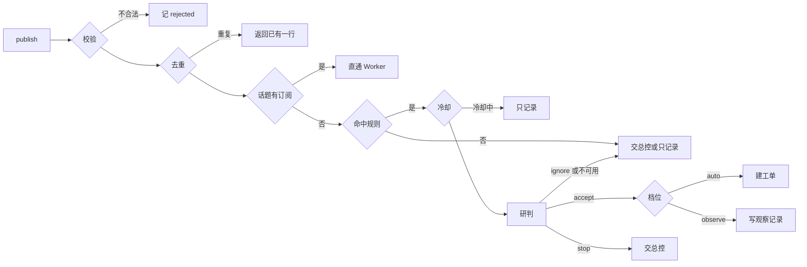

# 08 主动性与通道

本文定义 v3 怎样主动做事、怎样少打扰人：注意力纪律、事件种类、内置事件规则、两级过滤与 observe/auto、目标模式、Watchdog、每日简报、IM 通道与发件箱，以及 v2 通知怎么并进来。表结构见 [03 §11](./03-数据模型.md)，端点、事件与配置见 [04 §2.4、§4、§6](./04-接口与事件协议.md)，后台代理与 schema 见 [05 §3.4、§8](./05-运行时与代理定义.md)。落地由 M81–M85 的 spec 完成，本文是它们共同的依据。

外层做法参照 DeepSeek Super-agent 文章的 §3（事件驱动、两级过滤）、§4（面向人的交互）、§6（Watchdog），以及它的原型里 Trigger、Eval、accept 档位与 Report 的处理方式；取舍以 02–05 为准。

## 1. 注意力纪律

人的注意力是 v3 最贵的资源。每条规则都写明在哪里落地；改规则时同步改落地处，尤其是共用约定 `maa_api/agent/specs/common.md`（[05 §7](./05-运行时与代理定义.md) 第 2 段，M70 建立）。

### 1.1 什么时候开口

| # | 规则 | 落地 |
|---|---|---|
| 1 | 接单确认一次：用户的请求变成工单时，总控回一句「已建工单「X」」，再加一句什么时候会有结果；不复述计划，不列步骤 | 总控提示词（M70） |
| 2 | 执行中安静：Worker 的 progress 汇报不转发；总控不主动报「还在跑」；用户问进度时才用 `get_ticket` 查了回答 | 05 §4.1 转发规则（M70） |
| 3 | 只在三种时候开口：有结果（ready）、要决策（waiting，带 `human_action`）、做不完（blocked、failed） | 同上 |
| 4 | 主动建的工单（来源不是 `user`）报 dropped 时不说；在 ready 之前不提前打招呼 | 05 §4.1（M70）、事件规则（M81） |
| 5 | 一次一问：总控会话同一时刻至多一个待答的 `ask_user`；几张工单都在等人时，问最急的一条，其余只进「待你处理」 | 总控提示词（M70） |
| 6 | 合并：批处理窗口 `orchestrator.batch_window_ms` 内到达的多条汇报合成一条回复 | OrchestratorService（M70） |
| 7 | 系统事件不直接对人说话：事件只有在 §2.3 判为「交总控」时才进总控收件箱，由总控决定怎么说 | TriggerService（M81） |
| 8 | 同一件事只开口一次：同一工单同一个 `human_action.ref_id` 的 waiting 只转发、只推送一次 | 汇报转发（M70）、推送（M82） |

### 1.2 长度

| 输出 | 上限 | 说明 |
|---|---|---|
| 总控在 Web 的一条回复 | 300 字 | 结论放第一句；数字用短列表；更长的内容写成产物（M75）给链接 |
| 总控在 IM 的一条回复 | `channels.max_reply_chars`（默认 300） | 超出就截断并附 Web 链接（M85）；DeepSeek 文章验证过的「一条不超过 100 词」是同一思路 |
| 汇报摘要 | 600 字 | 05 §4.1；`human_action.prompt` 不超过 200 字 |
| `ask_user` 的问题 | 200 字 | 给选项，选项不超过 6 个 |
| Web Push | 标题 40 字、正文 120 字 | 推送经过第三方服务，不放 token、密钥、绝对路径（沿用 v2 `build_confirmation_payload` 的口径） |
| 每日简报 | 摘要 600 字 | 全文写成产物（§7） |

### 1.3 哪些状态转发给人

| 来源 | 转发给总控 | 不转发 |
|---|---|---|
| Worker 汇报 | waiting、ready、blocked、failed；dropped 只在工单来源为 `user` 时 | progress |
| 订阅话题的事件 | 不转发，直通订阅它的 Worker | |
| 没有订阅的事件 | §2.3 判为「交总控」的种类；研判结果为 stop 的事件 | 其余只记录 |
| observe 规则的观察记录 | 不转发，只进事件规则页 | |
| Watchdog 告警 | critical（经 `watchdog.alert` 事件交总控） | info、warn |
| 用户在工单里说的话 | 写一条 `system` 项，总控能看到、不需要回复（02 §6.3） | |

### 1.4 指挥台只列什么

指挥台首页的「待你处理」只放需要人动手的事，健康状态不占位置：

- 待确认的工具调用（v2 全局确认面板的数据，带来源工单，M71）；
- 待答的提问（M71）；
- `human_action` 不为空的工单（waiting、blocked）；
- 没有处理的 critical Watchdog 告警（M83）。

不进「待你处理」的：内核与设备正常、队列正常、progress、观察记录（事件规则入口上只显示待审阅条数）、info 与 warn 告警（告警页可查）。

### 1.5 推送与 IM 的发送条件

「没有可见页面」沿用 v2 `ConnectionManager.has_visible_client()` 的判断：按页面可见性，不按有没有连接（v2 docs/09 §13.1，见 [v2/09](../v2/09-前端重构方案.md)）。

| 内容 | Web 指挥台 | Web Push | IM（M85） |
|---|---|---|---|
| 确认请求 | 全局确认面板（v2） | 没有可见页面时（v2，不变） | 已绑定就发；破坏类只给 Web 链接（V3-D25） |
| 工单汇报 waiting、ready、blocked、failed | 总控转述、工单列表 | 没有可见页面时（M82） | 最近一条用户消息来自 IM，或没有可见页面时 |
| 工单汇报 progress | 只在工单页 | 不推 | 不发 |
| critical 告警 | 待你处理、总控 | 没有可见页面时（M83） | 同工单汇报 |
| 每日简报 | 总控会话 | `brief.push_web` 为真且没有可见页面（M84） | `brief.push_im` 为真（M84、M85） |
| 观察记录、info 与 warn 告警 | 对应页面 | 不推 | 不发 |
| v2 通知事件 | 不变 | 不变 | 见 §9 |

同一工单的推送用 `tag = ticket:<id>` 合并，后到的替换先到的；同一工单 10 分钟内至多推一次（M82）。M85 起所有外发消息先进发件箱（§8），表中的条件由发件箱的写入方判断。

### 1.6 写法示例

共用约定与总控提示词按这组对照把握分寸（写进 common.md 时保留原句）：

| 场合 | 这样说 | 不这样说 |
|---|---|---|
| 接单 | 已建工单「日常」，跑完大约 40 分钟，有结果告诉你。 | 好的，我会先检查设备，然后提交流水线，接着…… |
| 结果 | 日常做完了：理智用完，公招 4 次，基建已换班。 | 任务执行成功，以下是详细报告： |
| 要决策 | 1-7 的理智药只剩 2 瓶，要用掉吗？（用 / 不用） | 我发现了一些情况，想和你确认几件事：第一…… |
| 做不完 | 剿灭没打成：设备断开后重连三次都失败。要我等你处理模拟器，还是先取消？ | 执行过程中出现了一些问题。 |
| 主动工作 | （诊断工单 ready 后）昨晚 23:10 的流水线失败是因为游戏弹出了维护公告，已截图，今天的定时任务不受影响。 | （刚建诊断工单时）我注意到一条流水线失败了，正在为你分析。 |

## 2. 事件种类

### 2.1 约定

- 事件就是一行 `agent_trigger`（03 §11.1）。写入只有一个入口：`TriggerService.publish(...)`（M81）。Web 发给总控与工单的消息不进事件表，它们直接写收件箱（02 §6.1、§6.3）。
- `kind` 写成 `<领域>.<动作>`，匹配 `^[a-z]+\.[a-z_]+$`，不超过 48 个字符；领域取 pipeline、core、device、schedule、system、goal、watchdog、im。只有下表登记过的种类能入表，未登记的种类按 `rejected` 记一行。
- `thread_key` 的前缀与 `source` 必须对应（03 §15）。
- `payload` 序列化后不超过 16 KiB；时间字段一律 ISO 8601 带 `Z`；错误信息类字符串截到 500 字。超限的事件按 `rejected` 记一行，payload 只留 `{"rejected": "payload_too_large", "size": N}`。
- `dedupe_key` 写了就全局唯一（部分唯一索引）。同一个键第二次发布不入表、不处理，`publish` 返回已有的那一行并标 `duplicate`。事件的多个来源（例如流水线失败既从终态钩子来，也从诊断入口来）用同一个键，先到的生效。
- 系统事件的 `sender` 为空；IM 事件写绑定身份 `im:<platform>:<user>`。

### 2.2 种类表

流水线的公共 payload：`pipeline_id`、`title`、`source`、`status`、`error_code`、`error_message`、`schedule_id`、`ticket_id`（提交它的工单，按 `pipeline.agent_session_id` 所属会话的 `ticket_id` 求，没有为 null）、`started_at`、`finished_at`、`tasks`（至多 10 条，每条 `name`、`type`、`status`、`error_code`）。

| source | kind | thread_key | payload | dedupe_key | 由哪个接缝发出 | 里程碑 | 无工单处理时 |
|---|---|---|---|---|---|---|---|
| pipeline | `pipeline.completed` | `pipeline:<id>` | 公共字段 | `pipeline:<id>:completed` | `FinishHookFanout` 的订阅者 `PipelineEventPublisher`（替换 M70 接上的 ThreadRouter 订阅者） | M81 | 只记录 |
| pipeline | `pipeline.failed` | `pipeline:<id>` | 公共字段 | `pipeline:<id>:failed` | 同上；另由 `AgentIncidentService.pipeline_failed` 补发（重启恢复与领取失败的流水线不经过终态钩子） | M81 | 只记录 |
| pipeline | `pipeline.cancelled` | `pipeline:<id>` | 公共字段 | `pipeline:<id>:cancelled` | 同 completed | M81 | 只记录 |
| pipeline | `pipeline.core_crash_linked` | `pipeline:<id>` | `pipeline_id`、`core_generation`、`error_message` | `pipeline:<id>:core:<generation>` | `AgentIncidentService.pipeline_failed`：已经报过失败的流水线后来被改判为内核崩溃时 | M81 | 只记录 |
| core | `core.crashed` | `core:default` | `core_id`、`generation`、`reason`、`exitcode`、`attempt`、`at`、`detail` | `core:default:<boot_id>:<generation>` | main.py `on_core_crash` 派发到 `AgentIncidentService.core_crashed`，并掉运行中流水线的崩溃之后才发 | M81 | 只记录 |
| core | `core.failed` | `core:default` | `core_id`、`generation`、`last_crash` | `core:default:<boot_id>:<generation>:failed` | main.py `publish_core_state`：状态变为 `failed`（自动重启次数用完） | M81 | 交总控 |
| device | `device.connected` | `device:default` | `core_id`、`address`、`previous_state` | 无 | main.py `publish_device_status`，只在状态变化时发 | M81 | 只记录 |
| device | `device.disconnected` | `device:default` | connected 的三项 + `state`、`error_stage` | 无 | 同上：从 `connected` 变为 `disconnected` 或 `reconnecting` | M81 | 只记录 |
| device | `device.unavailable` | `device:default` | 同 disconnected + `retry_attempt` | 无 | 同上：变为 `unavailable`（重试次数用完） | M81 | 交总控 |
| schedule | `schedule.fired` | `schedule:<rule_id>` | `rule_id`、`scheduled_for` | `schedule:<rule_id>:<scheduled_for>` | 事件规则自己的定时 job `maa-trigger-rule-<rule_id>` | M81 | 只记录 |
| system | `system.update_available` | `system:update_available` | `target`、`channel`、`current`、`latest` | `update_available:<target>:<channel>:<latest>` | `UpdateService` 的 `broadcast` lambda（main.py 约 931 行）；v2 每个版本只广播一次，一个目标一条事件 | M81 | 只记录 |
| system | `system.sanity_full` | `system:sanity` | `estimated`、`max_sanity`、`observed`、`observed_at`、`stage_code`、`full_at` | `sanity_full:<observation_id>` | 理智估算 job `maa-trigger-sanity`（每 30 分钟，按最近一次 `sanity_observation` 每 6 分钟回 1 点估算） | M81 | 只记录 |
| goal | `goal.review_due` | `goal:<id>` | `goal_id`、`title`、`snapshot`（§5） | `goal:<id>:review:<scheduled_for>` | 复盘 job `maa-goal-review-<goal_id>` | M82 | 只记录 |
| goal | `goal.completed` | `goal:<id>` | `goal_id`、`title`、`via` | `goal:<id>:completed` | GoalService 判定完成时 | M82 | 交总控 |
| goal | `goal.deadline_passed` | `goal:<id>` | `goal_id`、`title`、`deadline`、`snapshot` | `goal:<id>:deadline` | GoalService 复盘时发现过了截止 | M82 | 交总控 |
| watchdog | `watchdog.alert` | `watchdog:<check>` | `alert_id`、`check`、`severity`、`target_kind`、`target_id`、`message`、`action`、`action_status` | `watchdog:alert:<alert_id>` | WatchdogService 新建告警时 | M83 | critical 交总控，其余只记录 |
| im_* | `im.message` | `im:<platform>:<chat_id>` | `binding_id`、`message_id`、`text`、`reply_to` | `im:<platform>:<message_id>` | ChannelService 收到已绑定身份的消息 | M85 | 交总控（作为用户消息） |

`core.crashed` 只表示「没有流水线在跑时内核崩溃」：运行中的崩溃合并进该流水线的 `pipeline.failed`（`error_code=CORE_CRASHED`），与 v2 自动诊断「流水线执行期间的 core crash 与该 pipeline incident 合并」一致（[v2/11 §10](../v2/11-Agent模块设计.md)）。

### 2.3 去向

一条事件依次检查四个去处，找到第一个就停：

1. 话题有活跃订阅：直通订阅它的每个工单的 Worker 收件箱（`kind='thread_event'`，`ref_id` 为事件 id），`routed_to='ticket'`。即使主动工作总开关关着也照常直通，否则 Worker 等不到自己提交的流水线。
2. 命中一条启用的事件规则：按 §4 研判，auto 建工单、observe 写观察记录。
3. 种类在「交总控」集合里：写总控收件箱（`kind='trigger'`，转成以「【事件】」开头的消息，05 §2.4），`routed_to='orchestrator'`。`im.message` 例外，它写成 `user_message`。
4. 其余只记录，`routed_to='none'`。

第 2 步没有建工单（研判为 ignore、observe 档、研判不可用）时，若种类在「交总控」集合里，仍执行第 3 步；这时 `routed_to` 记 `orchestrator`，观察记录照常写。「交总控」集合：`core.failed`、`device.unavailable`、`goal.completed`、`goal.deadline_passed`、severity 为 critical 的 `watchdog.alert`、`im.message`。

### 2.4 事件摘要

每个种类有一句固定格式的摘要，用于总控收件箱的事件卡、事件列表、研判的事件卡与推送标题（M81 的 `maa_api/agent/events/kinds.py`）。花括号是 payload 字段，缺值写「未知」，整句不超过 200 字。

| kind | 摘要 |
|---|---|
| `pipeline.completed` | 流水线「{title}」已完成 |
| `pipeline.failed` | 流水线「{title}」失败：{error_message} |
| `pipeline.cancelled` | 流水线「{title}」已停止 |
| `pipeline.core_crash_linked` | 流水线 {pipeline_id} 的失败归因到内核第 {core_generation} 代崩溃 |
| `core.crashed` | 内核第 {generation} 代崩溃（{reason}），没有流水线在跑 |
| `core.failed` | 内核自动重启次数用完，需要手动启动 |
| `device.connected` | 设备已连接（{address}） |
| `device.disconnected` | 设备连接断开（{address}） |
| `device.unavailable` | 设备重连 {retry_attempt} 次都失败，暂时不可用 |
| `schedule.fired` | 定时规则 {rule_id} 到点 |
| `system.update_available` | {target} 有新版本 {latest}（当前 {current}） |
| `system.sanity_full` | 理智估计已满（{estimated}/{max_sanity}） |
| `goal.review_due` | 目标「{title}」到了复盘时间 |
| `goal.completed` | 目标「{title}」已完成 |
| `goal.deadline_passed` | 目标「{title}」过了截止还没完成 |
| `watchdog.alert` | {message} |
| `im.message` | IM 消息：{text} |

## 3. 内置事件规则

### 3.1 字段与合并

规则的字段即 `trigger_rule` 的列（03 §11.2）。内置规则写在 `maa_api/agent/events/builtin_rules.py`；表里只存覆盖与用户规则，覆盖行里为空的列沿用内置值，与 v2 知识库的覆盖层同一口径（覆盖与内置完全一致且启用时不留行，「恢复默认」就是删行）。

- `source` 为空表示任何来源；`kind_pattern` 用 `fnmatch` 匹配 `kind`；`conditions` 是对 payload 字段的等值、属于、比较条件（M81 spec 定义写法）。
- `policy` 是给研判代理的提示。为空串的规则不研判，命中即按 accept 处理，`eval_status='skipped'`。
- `cooldown_seconds` 按（规则、话题）计：同一话题上这条规则在冷却期内已经建过工单或写过观察记录，新事件只记录，`eval_reason='cooldown'`。
- 定时来源的规则带 `cron`，按 `Asia/Shanghai` 解释（与 v2 定时任务默认时区一致），只匹配自己的 job 发出的 `schedule.fired`。
- 一条事件至多命中一条规则：内置规则按声明顺序在前，用户规则按 id 排在后，取第一条。
- 用户新建规则不写档位时取 `triggers.default_mode`（默认 observe）。内置规则各自带默认档位。

### 3.2 内置规则表

| id | 来源与种类 | 条件 | 默认档位 | Worker | 研判提示要点 | 冷却 | 里程碑 |
|---|---|---|---|---|---|---|---|
| `diagnose-pipeline-failure` | pipeline / `pipeline.failed` | 无 | auto | `diagnose` | 不研判，命中即建诊断工单 | 0 | M81 |
| `diagnose-core-crash` | core / `core.crashed` | 无 | auto | `diagnose` | 不研判，命中即建诊断工单 | 0 | M81 |
| `sanity-full` | system / `system.sanity_full` | 无 | observe | `daily_ops` | 没有排队或运行中的流水线、一小时内没有会用理智的定时任务时，建议提交一条只用现有理智的刷图流水线，关卡沿用最近一次刷的；否则 ignore | 21600 | M81 |
| `device-unavailable` | device / `device.unavailable` | 无 | observe | `ops` | 有排队的流水线或一小时内会到点的定时任务时，建议建运维工单检查设备与模拟器，只做重连、查状态这类不用确认的事；否则 ignore | 3600 | M81 |
| `update-available` | system / `system.update_available` | `target` 属于 core、resource | observe | `ops` | 没有流水线在跑时，建议建运维工单读更新说明，在汇报里请用户决定要不要更新（更新本身要确认，推断委托做不了）；否则 ignore | 86400 | M81 |
| `goal-review` | goal / `goal.review_due` | 无 | auto | `planner` | 进度正常、没有到期的里程碑时 ignore；里程碑逾期、养成计划已完成或停了、定时任务被删或停用、截止临近而进度落后时 accept，建复盘工单 | 0 | M82 |
| `watchdog-followup` | watchdog / `watchdog.alert` | `severity` 为 critical，`target_kind` 属于 device、core | observe | `diagnose` | 30 分钟内没有诊断工单在处理同一目标时，建议建诊断工单看现场，能用返回主界面或重连设备恢复就恢复；否则 ignore | 1800 | M83 |

`goal-review` 默认 auto：目标是用户明确建立的，复盘是它的一部分，先由研判挡住进度正常的日子，研判通过才起 Worker。它与 V3-D51「主动工作默认 observe」的口径不同，理由记在 M82 spec，等用户确认。

内置规则的工单草稿：研判通过时用研判给的标题、说明与范围，研判没写的部分以及不研判的规则，用规则自带的草稿函数生成（诊断规则带上失败的流水线、任务、错误与崩溃截图 id；复盘规则在说明末尾附上汇报格式）。

### 3.3 两条诊断规则与总开关

`agent.auto_diagnose_failures`（v2 设置，默认开）是两条诊断规则的总开关：它为假时两条规则的生效档位按 off 处理，覆盖层写的档位不起作用；规则页显示「受自动诊断开关控制」。它们承接 v2 自动诊断的行为（每条失败的流水线、每次空闲内核崩溃至多一张诊断工单，重放不重复建单），去重靠 §2.1 的 `dedupe_key`。与 v2 的差别只有一处：提交这条流水线的工单还订阅着它的话题时，失败直通那张工单，由它自己处理，不另建诊断工单（§2.3 第 1 步）。

## 4. 两级过滤与 observe/auto

### 4.1 处理管线

同一话题的事件按到达顺序串行处理，保证先建的工单与订阅能接住同一话题的后续事件。事件在处理前先入表；进程在处理中途退出时，下次启动把 24 小时内没处理完的事件按 id 顺序补处理，建单、写观察记录、写收件箱都先查是否已经做过。

### 4.2 第一级：程序准入

程序准入挡住大部分事件，只用确定的条件，不调模型：

- 校验：来源、种类、话题前缀、payload 大小（§2.1）。不合法的 `admission='rejected'`。
- 去重：`dedupe_key`。
- 订阅直通：已归属的话题不再判断。
- 规则匹配：来源、种类模式、条件、启用与生效档位、冷却。
- `triggers.enabled` 为假时跳过规则匹配，事件只走订阅直通与「交总控」。

`admission` 的含义：`accepted` 表示事件进了某个去处（订阅、规则、总控）；`ignored` 表示合法但没有去处；`rejected` 表示不合法。

### 4.3 第二级：研判

命中规则、不在冷却、规则的 `policy` 不为空时，由后台代理 `trigger_evaluator`（`model_role=trigger_eval`，便宜模型）研判，输出 `trigger_decision`（05 §8）。研判看到的事件卡包括：事件本身（payload 截到 4000 字）、规则与研判提示、规则指定的 Worker 及其描述、至多 8 张进行中的工单（标题、种类、状态、摘要）、这个话题最近 5 条事件的去向。事件卡里的外部内容按不可信数据处理。

| 研判结果 | auto 档 | observe 档 |
|---|---|---|
| accept | 建工单：推断委托、风险上限 none、`sender=rule:<id>`；工单订阅事件的话题 | 写观察记录，`decision` 为本来会建的工单草稿 |
| stop | 交总控，附研判理由，由总控决定要不要取消相关工单 | 写观察记录，`decision.decision='stop'` |
| ignore | 只记录 | 只记录 |
| 不可用 | 按 §2.3 第 3、4 步 | 同左 |

不可用包括：当天研判次数达到 `triggers.eval_daily_limit`（`eval_reason='daily_limit'`）、模型没配置、结构化输出两次都不合法、超出成本预算。研判次数按本地时间的自然日计数，进程重启不清零。

主动建的工单：`origin` 按事件来源取（`goal` 来源为 goal，`watchdog` 来源为 watchdog，其余为 trigger），`ticket.source_trigger_id` 指回事件，委托的 `policy_version` 是生效规则集的哈希。

### 4.4 observe 与 auto 的生命周期

每条规则三档：off（不匹配）、observe（只记录本来会做什么）、auto（真的建工单）。新规则默认 observe（V3-D51）。档位只由用户在事件规则页切换，系统不自动升降档，只给建议。

观察记录（`trigger_observation`）在事件规则页的「待审阅」里逐条显示：事件摘要、规则、本来会建的工单（Worker、标题、说明、范围）、研判理由。用户标「判断对了」（good）或「不该处理」（bad），可以改判。

### 4.5 升档与降档建议

`GET /api/agent/trigger-rules` 给每条规则附 30 天统计，界面据此提示：

- 建议改为 auto：最近 30 天至少 10 条观察记录被审阅，其中 good 不少于 90%，且最近 5 条审阅没有 bad。
- 建议改回 observe：auto 规则最近 30 天建了至少 5 张工单，其中以 cancelled 或 failed 结束的不少于 40%。

## 5. 目标模式

目标（`goal`，03 §11.4）是用户明确提出的长程事情，例如「月底前把银灰练到精二专三」。执行仍靠 v2 的养成计划与定时任务，目标负责拆里程碑、盯进度、按时复盘（M82）。

1. 建立：总控的 `create_goal` 工具或 `POST /api/agent/goals`。GoalService 写目标行，注册复盘 job，并建一张 `planner` 规划工单（`origin=goal`，`goal_id` 指回目标，订阅 `goal:<id>`）。规划工单是用户这次明确要求的一部分，委托强度为 explicit，风险上限取 `planner` 的定义（consume），所以 `start_upgrade_plan`、带理智药的 `create_schedule` 照 v2 口径逐次确认。
2. 规划：Worker 拆出 1–12 个里程碑，按需用 `start_upgrade_plan` 建养成计划、用 `create_schedule` 建定时任务，最后汇报 ready，`details.goal_plan` 写里程碑与定时任务 id。GoalService 写入里程碑；养成计划按 `upgrade_plan.session_id` 等于这张工单的 Worker 会话找到，不依赖模型报 id。
3. 复盘：每天按 `goal.review_cron`（默认取 `goals.default_review_cron`，`0 22 * * *`）先做确定性的部分：把过了 `due_at` 还没完成的里程碑标为 missed，读养成计划状态与定时任务是否还在，判断是否完成、是否过了截止；然后发 `goal.review_due`。复盘规则研判通过才建复盘工单（推断委托、风险上限 none），复盘工单汇报 ready 时用 `details.goal_review` 更新里程碑。
4. 完成：关联的养成计划已完成、里程碑全部 done 或 skipped 时，GoalService 把目标标为 done 并发 `goal.completed`。截止过了还没完成时发一次 `goal.deadline_passed`，目标保持 active，由用户改截止或取消。
5. 暂停与取消：暂停时停用关联的定时任务并暂停复盘 job；恢复时重新启用，定时任务里有消耗项时按 v2 定时任务口径确认（`update_goal` 为 CONDITIONAL，05 §6.1）。取消时停用定时任务、取消进行中的养成计划与目标工单、移除复盘 job。

复盘快照（`goal.review_due` 与 `goal.deadline_passed` 的 `snapshot`，也写进 `goal.progress.last_snapshot`）：

| 字段 | 内容 |
|---|---|
| `now`、`deadline`、`days_left` | 复盘时刻、截止、剩余天数（没有截止为 null） |
| `milestones` | 每个里程碑的 `ord`、`title`、`status`、`due_at`；本次新标为 missed 的另列在 `newly_missed` |
| `plan` | 关联养成计划的 `id`、`status`、`progress` 里的剩余关卡与场次；没有关联为 null |
| `schedules` | 关联定时任务分成 `ok`、`disabled`、`missing` 三组 id |
| `tickets` | 这个目标进行中的工单 id 与状态 |
| `last_review_at` | 上一次复盘时间 |

目标工单只做目标范围内的事：规划工单与复盘工单的委托范围都写明「只改动为本目标建立的养成计划与定时任务」。

## 6. Watchdog

Watchdog 是主系统之外的控制回路（DeepSeek 文章 §6）：不在任何代理的运行里，由定时 job 驱动，先做确定性检查，再对可疑工单做一次模型语义检查（后台代理 `watchdog`，05 §3.4）。`watchdog.mode` 为 record 时只记告警，auto 时执行有限的自愈动作（V3-D52）。

### 6.1 检查项

| check | 目标 | 判定条件 | 级别 |
|---|---|---|---|
| `run_heartbeat_stale` | run | 本进程的运行处于 `running`，`heartbeat_at` 早于 `agent.run_stale_seconds` 之前（其他进程留下的由 M66 的启动恢复处理） | warn |
| `ticket_stale` | ticket | 工单 `open`，Worker 没有活动运行、收件箱没有待处理项，订阅的流水线都不在排队或运行，最近一次活动早于 `watchdog.ticket_stale_minutes` 之前 | warn |
| `ticket_churn` | ticket | 最近 60 分钟这张工单的 Worker 起了至少 12 轮运行，期间没有 progress 以外的汇报 | warn |
| `pipeline_no_callback` | device | 有流水线在执行，当前任务开始后超过 `watchdog.device_frozen_minutes` 没有收到任何内核回调（时间戳来自 `CoreClient.on("CALLBACK", ...)` 的记录器） | critical |
| `core_not_ready` | core | 内核状态为 starting、restarting、crashed 持续 10 分钟以上，或状态为 failed | critical |
| `queue_stuck` | queue | 有可领取的排队流水线超过 10 分钟，队列没暂停、内核就绪、设备已连接、没有租约、执行器却空闲 | critical |
| `ticket_no_progress`、`ticket_drift` | ticket | 语义检查：对 `ticket_stale`、`ticket_churn` 挑出的工单（每轮至多 2 张，每张每小时至多 1 次），由 `watchdog` 代理判断是否没有实质进展、是否偏离委托 | 代理给出 |

同一目标同一检查有未处理的告警时不重复建；条件消失后自动标为已处理。

### 6.2 动作

| 动作 | 触发 | record 档 | auto 档 |
|---|---|---|---|
| `interrupt_run` | `run_heartbeat_stale` | 只记 | 走 M70 的中断入口；30 秒后仍是 running 就直接把运行标为 interrupted |
| `mark_blocked` | `ticket_stale`；语义检查建议且同一工单也被确定性检查挑中 | 只记 | 写一条 blocked 汇报（带 `human_action`，问用户继续还是取消），照常转给总控 |
| `stop_pipeline` | `pipeline_no_callback` | 只记 | 调 v2 的停止流水线（`PipelineRunner.request_cancel`） |
| `restart_core` | `core_not_ready` | 只记 | 仅在 `watchdog.allow_core_restart` 为真且没有流水线在执行时重启内核；否则 `action_status='skipped'` |
| `wake_queue` | `queue_stuck` | 只记 | 唤醒执行器；执行器任务已经退出时只记告警，提示重启服务 |

critical 告警进「待你处理」，并发 `watchdog.alert` 事件交总控；没有可见页面时推送（§1.5）。

告警的 `action_status`：record 档写 `recorded`；auto 档执行成功写 `done`、失败写 `failed`、条件不满足（例如不允许重启内核）写 `skipped`。`evidence` 记判定用到的事实（运行 id 与心跳时间、工单最近活动时间、当前任务与最后一次回调时间、内核状态与持续时长、排队数与最早一条的时间），便于事后核对误判。

运行方式：

- 一个每 60 秒触发的 job `maa-watchdog`，距上一轮不足 `watchdog.interval_seconds` 就跳过；改间隔不用重启。
- 确定性检查只读库与进程内状态，不调模型、不写 `agent_run`；只有语义检查起一次 `watchdog_check` 运行（没有会话，03 §3.2）。
- 进程卡死或退出时 Watchdog 也一起停下，那属于部署层的事（launchd、systemd 或容器的重启策略，见部署指南）。

## 7. 每日简报

每天 `brief.cron`（默认 `0 8 * * *`）由 BriefService 直接建一张简报工单（M84），不经事件规则：`brief.enabled` 已经是它的开关，简报也不该因为研判不可用而缺席。`POST /api/agent/brief/run` 立即生成一份。

- 工单：`kind=analyst`、`origin=system`、推断委托、风险上限 none；同一天自动生成的至多一张，手动生成不受限。
- 内容：理智估算（含回满时间）、昨天与今天的消耗（按任务参数上限计）、昨天的流水线（数量、失败及原因）、掉落要点、结束的工单与仍在等人的事、未处理的告警、成本、今天会到点的定时任务、当期活动与卡池、目标进度，以及 1–5 条今日建议。
- 汇报 ready 时摘要不超过 600 字，全文写成 `report` 产物（M75）。总控收到后转述一次；`brief.push_web` 与 `brief.push_im` 决定是否推送与发 IM（§1.5）。

## 8. IM 通道与发件箱

本节只是概要，细节由 M85 spec 定义。

- 首批四个平台：Telegram、飞书、钉钉、QQ 官方机器人（V3-D53）。企业微信与 QQ 个人号不做。
- 身份绑定：用户在设置页对某个平台取一次性绑定码（10 分钟有效），在 IM 里发给机器人；只有已绑定身份的消息会进系统（V3-D54），其余丢弃并记日志。
- 进来：已绑定身份的消息发布为 `im.message` 事件。默认进总控会话，与 Web 是同一个连续会话；回复某条属于工单的机器人消息时，进那张工单（按发件箱回执找到工单），总控收到摘要。
- 确认：IM 里能批准消耗类确认与原子操作授权；破坏类确认默认只给 Web 链接，`channels.allow_destructive_approval` 为真才放开（V3-D25），否则返回 `CHANNEL_APPROVAL_NOT_ALLOWED`。
- 出去：所有外发消息（IM 回复、汇报、确认、简报、告警、Web Push）先写 `outbox`，带去重键，提交后由投递循环发送，失败按退避重试，多次失败后标 dead（V3-D55）。进程重启后从待发与发送中的行继续，已发送的不重发。
- 长度：IM 回复按 `channels.max_reply_chars` 截断并附 Web 链接（§1.2）。

实现注记（M85）：四个平台都用长连接/轮询接收（Telegram `getUpdates`、飞书与钉钉的 WebSocket、QQ 网关），不新增 HTTP 回调端点；签名/解密校验在适配器内完成。`im.message` 的 payload 按 §2.2 带 `binding_id`/`message_id`/`text`/`reply_to`，另带 `platform`/`external_chat_id`。发件箱从 M85 起承接 v3 的外发消息（IM 回复、汇报、确认、简报、critical 告警）与 v3 的 Web Push；v2 的三处通知出口（Q7=A）保持原样。09 §5 的 IM 审批令牌、时钟偏差、`ask_user` 作答等细则本里程碑未实现，留作后续。

## 9. v2 通知与 v3 主动性的关系（待拍板 Q7）

v2 有三层触达（[v2/09 §13](../v2/09-前端重构方案.md)）：后端多通道通知 `NotifyService` 是保底层（邮件、Webhook、Bark、钉钉、企微；流水线终态、内核崩溃、更新、确认、养成计划完成、作业研究结束），Web Push 是即时层（确认、养成计划完成、作业研究结束），WebSocket 是前台层。v3 又多了总控转述、M82 的工单推送、M83 的告警推送、M84 的简报与 M85 的 IM。同一件事可能从几处同时到达，例如流水线失败：Bark 先说一次，诊断工单 ready 后总控再说一次，没开页面时还会收到推送。

| 选项 | 做法 | 好处 | 代价 |
|---|---|---|---|
| A 维持现状（当前默认） | v2 通知一律不变；v3 的消息另走总控、Web Push、IM | 不回退；用户已有的通道配置照常 | 重复：失败、确认可能各收两条 |
| B 全部经总控合并 | v2 的通知事件改成事件交总控，由总控决定说不说；`NotifyService` 变成发件箱的一种通道 | 只有一个声音，最符合注意力纪律 | 保底层依赖模型可用，模型挂了就没有通知；推翻 v2「保底层不依赖前端与模型」的设计 |
| C 分层保留、按事件去重（建议） | `NotifyService` 继续作保底层、不经模型，事件与通道配置不变；Web Push 与 IM 从 M85 起都经发件箱，v2 的确认、养成计划完成、作业研究结束推送改写发件箱并用同一套去重键；v3 不为 v2 已覆盖的事件（流水线终态、内核崩溃、更新）另发推送，只在有结论时由总控转述 | 保底仍在；推送不重复；改动集中在 M85 | 外部通道（Bark 等）与总控的转述仍可能各说一次，由用户在通道配置里关掉不想要的事件 |

建议选 C，在 M84 开工前拍板（13 §9 Q7）。选 C 时 M85 的 spec 要列出 v2 推送改走发件箱的三处调用点（`ConfirmationService._push_confirmation`、养成计划完成通知、main.py 的 `_copilot_notify`），并保证改造后推送条件不变。
