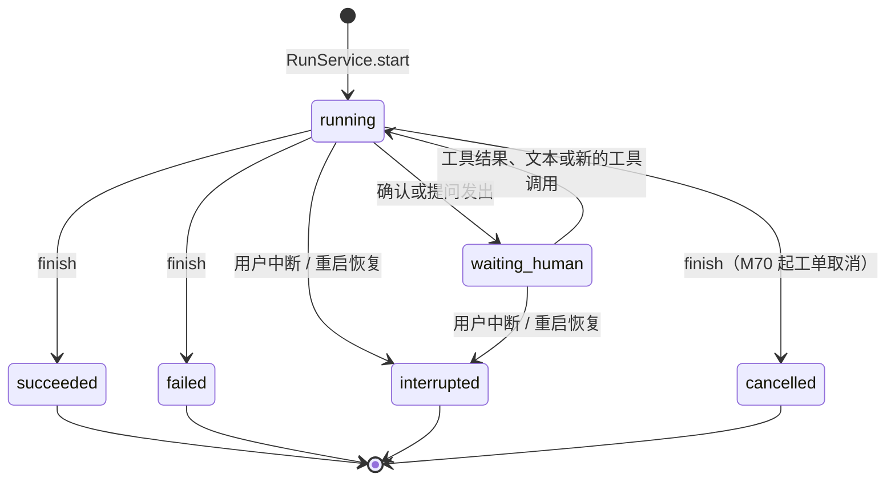
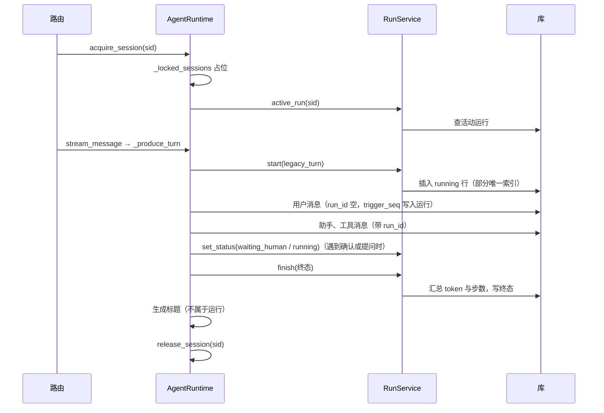

# M66 运行树与持久化运行（规格）

> 阶段：P0　依赖：M65（以及 M64 的现行接口清单与断链检查）　分支：`durable-runs`　迁移：`0023_agent_runs`
> 本文是 M66 的唯一规格；实施偏离记在 [13 §8](../13-决策记录.md)。

## 0. 前置检查

先 `mkdir -p /tmp/maa_m66`，在仓库根目录逐条执行下面的命令块（`# 0.N` 对应表格行）。任何一条不符合期望，停下来报告。

| # | 检查什么 | 期望 |
|---|---|---|
| 0.1 | 在 `durable-runs` 分支，基点是 dev | 首行 `## durable-runs`；除未跟踪的 `docs/ideas/` 外没有改动；末行 `ok` |
| 0.2 | M64、M65 已合并 | 两行：`v3-m64`、`v3-m65` |
| 0.3 | M64 的活文档与断链门禁在 | 两个路径都列出；末行 `BROKEN 0` |
| 0.4 | M65 的 harness 名字在 | 第一条 2 行（`AgentLoop`、`RunContext`）；第二条的输出里 `run_id`、`root_run_id`、`parent_run_id`、`cancel_event` 都出现；第三条至少 1 行 |
| 0.5 | v2 门面方法还在 | 12 个定义都能找到（11 个在 `maa_api/agent/runtime.py`，`build_model_context` 可能被 M65 挪进 `maa_api/agent/harness/`） |
| 0.6 | 门面是否经 AgentLoop；消息写入点 | 两条的输出都原样记进台账。第一条有输出说明门面在 `_run_turn` 一侧构造了 `RunContext`，T5 第 7 步要做 |
| 0.7 | 迁移 head | `0022_skland_only_operators.py`；不是它就取下一个可用编号，记进台账 |
| 0.8 | 本里程碑的名字还不存在 | 没有输出 |
| 0.9 | 两处契约已有结论 | 两条都至少 1 行，见 §10 第 1、2 条 |
| 0.10 | 计数基线 | 记下三个计数常量、路由总数句与 agent 小节的条数（M65 之后预期 125 / 124 / 20、123 条、agent 小节 20 条；以实际输出为准） |
| 0.11 | 测试与冒烟基线 | 记下 pytest 退出码与失败用例；`agent_smoke.py` 末行 `SMOKE OK` |

```bash
# 0.1
git status -sb && git merge-base --is-ancestor dev HEAD && echo ok
# 0.2
git tag -l 'v3-m64' 'v3-m65'
# 0.3
ls docs/v3/14-现行接口清单.md scripts/check_doc_links.py && .venv/bin/python scripts/check_doc_links.py | tail -n 1
# 0.4
rg -n '^class (AgentLoop|RunContext)\b' maa_api/agent/harness/
rg -n '\b(run_id|root_run_id|parent_run_id|cancel_event)\b' maa_api/agent/harness/context.py
rg -n 'agent_spec_registry' maa_api/main.py
# 0.5
rg -n 'def (acquire_session|release_session|turn_running|interrupt_turn|stream_message|run_incident|_produce_turn|_run_turn|_persist_message|_interrupted_now|_clear_interrupt|build_model_context)\b' maa_api/agent
# 0.6
rg -n 'RunContext\(' maa_api/agent/runtime.py
rg -n 'AgentMessage\(' maa_api --glob '*.py'
# 0.7
ls maa_api/db/migrations/versions/ | grep -v __pycache__ | sort | tail -n 1
# 0.8
rg -n 'class AgentRun\b|"agent_run"|run_heartbeat_seconds|run_stale_seconds|RUN_NOT_FOUND|RUN_ALREADY_ACTIVE' maa_api config.template.yaml
# 0.9
rg -n 'RUN_ALREADY_ACTIVE.*AGENT_SESSION_BUSY|AGENT_SESSION_BUSY.*RUN_ALREADY_ACTIVE' docs/v3/13-决策记录.md docs/v3/04-接口与事件协议.md
rg -n '发起方' docs/v3/05-运行时与代理定义.md
# 0.10
rg -n '^ALL_CODE_COUNT|^HTTP_BOUND_CODE_COUNT|^SECTION_COUNT' tests/domain/test_errors.py
rg -n '共 [0-9]+ 条 HTTP 端点|^### 6\.15|^（[0-9]+ 条）' docs/v3/14-现行接口清单.md
# 0.11
.venv/bin/python -m pytest -q > /tmp/maa_m66/pytest-base.log 2>&1; echo $?; tail -n 5 /tmp/maa_m66/pytest-base.log
.venv/bin/python scripts/agent_smoke.py > /tmp/maa_m66/agent-smoke-base.log 2>&1; echo $?; tail -n 1 /tmp/maa_m66/agent-smoke-base.log
```

## 1. 背景与目标

v2 的会话锁（`_locked_sessions`）、在跑的轮次（`_active_turns`）、中断标记（`_interrupted`、`_interrupt_settling`）都只在进程内存里，按 `session_id` 记；服务一重启，这些状态全丢，被打断的那一轮在库里留下半截历史（工具调用没有对应的 tool 消息时，下一轮请求会被上游以 400 拒绝）。M66 把「一次代理调用」落成 `agent_run` 表，为 M70 起的总控、Worker、子代理打底。

做完以后可以验证：

1. 迁移 `0023_agent_runs` 建出 `agent_run`，给 `agent_session` 加 `kind`、`parent_session_id`、`archived_at`，给 `agent_message` 加 `run_id`；已有的诊断会话（`incident_key` 非空）`kind` 为 `incident`，其余为 `chat`；升级与降级都不丢消息。
2. v2 门面的每一轮（`stream_message` 的对话、`run_incident` 的诊断）恰好产生一条 `kind=legacy_turn` 的运行，`agent_name` 是 `legacy_chat` 或 `legacy_incident`，终态、`finish_reason`、token 与步数和这一轮一致；这一轮写出的助手、工具、系统消息都带 `run_id`。
3. 同一会话并发发两条消息，第二条仍得到 409 `AGENT_SESSION_BUSY`；库里已有另一个存活进程的活动运行时也一样。部分唯一索引保证一个会话至多一个活动运行。
4. 中断状态按 `run_id` 记，v2 的中断行为与测试不变。
5. 活动运行每 `agent.run_heartbeat_seconds` 秒刷新一次 `heartbeat_at`。
6. 服务重启后，上一进程留下的活动运行变成 `interrupted`、`finish_reason='recovered_after_restart'`；该会话补齐未配对的 tool 桩消息并追加一条恢复提示；下一轮照常可用。
7. `GET /api/agent/runs` 与 `GET /api/agent/runs/{run_id}` 可用，未知运行返回 404 `RUN_NOT_FOUND`。
8. v2 会话的 SSE 事件名、顺序与字段不变；`tests/agent/` 与 `tests/api/` 里的既有用例全部通过。

## 2. 非目标

- 不改 v2 的 SSE 事件与字段，不给 v2 的会话、消息 wire（`session_wire`、`message_wire`）加字段；运行信息只经新的 runs 端点暴露。
- 不建总控、Worker、子代理运行（M70）；M48 的侦察子代理（`delegate_recon`）不记成子运行，M70 的 `delegate` 取代它时自然成为子运行。
- 恢复只做 [02 §6.5](../02-系统架构.md) 的第 1、2 步与本 spec 的补桩；第 3 步工单（M69）、第 4 步租约（M71）不做；第 5 步待确认与待提问已由 lifespan 里 `ConfirmationService.start()` 与 `QuestionService.reset_after_restart()` 处理，不重复。
- 不做成本与缓存 token 的核算（M67）：`cached_tokens`、`reasoning_tokens`、`cost_micros` 保持 0，`currency`、`model_profile` 保持空。
- 不建 trace span（M68）。
- 不给 `agent_run` 加保留规则；运行只随会话删除（外键 CASCADE）。
- `archived_at`、`parent_session_id` 只建列，M70 起使用；v2 会话列表不按 `kind` 过滤（M70 建总控会话时再加）。
- 会话标题生成不记成运行（M70 的 `titler`）；能力探查不记成运行。
- 不改 `AgentIncidentService` 自己的 `boot_id`（它用于崩溃诊断的去重键，与运行无关）。
- 前端不改（只重新生成 OpenAPI 快照与类型）。

## 3. 相关文档

- [02 §2.2](../02-系统架构.md) 的 `RunService`、`RunRecovery` 两行；[02 §3](../02-系统架构.md) 第 6 条与末段；[02 §5](../02-系统架构.md) 装配顺序 1、3；[02 §6.5](../02-系统架构.md) 服务重启恢复。
- [03 §1](../03-数据模型.md) 约定、§1.1 必须同步的测试、§2 迁移编号、§3 运行树三张表、§13 三个枚举、§14 保留策略。
- [04 §1](../04-接口与事件协议.md) 通用约定；§2.1 的 M66 两行；§5 的 `RUN_NOT_FOUND`、`RUN_ALREADY_ACTIVE`；§6 的 `agent.run_heartbeat_seconds`、`agent.run_stale_seconds`；§7 现行接口清单。
- [05 §2](../05-运行时与代理定义.md) 运行时组成、§2.1 `RunContext`、§2.2 AgentLoop 算法、§2.3 运行状态与终止原因。
- v2：[v2/11 §5.4 本轮被中断时](../../v2/11-Agent模块设计.md)（`rg -n '^### 5\.4' docs/v2/11-Agent模块设计.md`）；[v2/04 §5.7–§5.8](../../v2/04-数据模型与持久化.md)（`rg -n '^### 5\.(7|8)' docs/v2/04-数据模型与持久化.md`）；[M22 中断规格](../../v2/superpowers/specs/2026-09-29-m22-agent-interrupt.md)；[M13 诊断规格](../../v2/superpowers/specs/2026-09-26-m13-agent-runtime.md)。
- 现行接口清单：`docs/v3/14-现行接口清单.md` 的 `### 4.11 Agent 与 LLM` 与 `### 6.15 agent`。
- 既有代码入口（2026-11-02 `dev` 的近似行号；M65 之后用符号名 `rg` 定位）：
  - `maa_api/agent/runtime.py`：`AgentRuntime.__init__`（约 557 行）与进程内状态（约 593–611 行）；`acquire_session`（613）、`release_session`（620）、`turn_running`（624）、`interrupt_turn`（634）、`_interrupted_now`（671）、`_clear_interrupt`（682）、`stream_message`（718）、`run_incident`（746）、`_save_incident_failure`（820）、`_produce_turn`（1070）、`_record_turn_failure`（1119）、`_run_turn`（1150，登记 `_active_turns`）、`_run_turn_body`（1182）、`_finish_interrupted_turn`（1481）、`_persist_message`（1908）、`_finish_with_text`（1960）；`build_model_context`（314，通用分支 `outgoing: dict[str, Any] = {"role": role}` 约 442 行）；常量 `INTERRUPTED_FINISH_REASON`（160）、`INTERRUPTED_TOOL_STUB`（168）、`TURN_FAILED_FINISH_REASON`（181）。
  - `maa_api/api/routers/agent.py`：`_LockedSessionStreamingResponse`（约 209 行）、`stream_session_message`（约 733 行，`acquire_session` 为假时 409 `AGENT_SESSION_BUSY`，约 748–751 行）、`get_session_detail` 的 `turn_running`（约 791 行）、`interrupt_session_turn`（约 804 行）、`_page`（236）、`_iso`（241）。
  - `maa_api/agent/incidents.py`：`_refresh_existing_pipeline_context` 用 `acquire_session` 自旋等锁（约 150–158 行），直接写两条消息（约 214–237 行）；`_create_and_run` 建诊断会话（约 359 行）；调 `run_incident`（约 451 行）。
  - `maa_api/db/models.py`：文件 docstring「28 张业务表」（第 1 行）；`AgentSession`（约 455 行）；`AgentMessage`（约 500 行）。
  - `maa_api/db/repositories/agent.py`：`AgentSessionRepository`、`AgentMessageRepository`（`next_seq` 约 234 行、`list_by_session` 约 243 行）。
  - `maa_api/main.py`：lifespan 局部变量初始化（约 470–483 行）；`confirmation_service.start()`（约 1174 行）；`question_service.reset_after_restart()`（约 1194 行）；`app.state.agent_runtime = agent_runtime`（约 1209 行）；`incident_factory = …`（约 1210 行）；启动失败清理的属性名单（约 1393–1411 行）；关闭流程（约 1423–1489 行）；`create_app` 的 `include_router`（约 1523–1544 行）；路由模块导入（约 49–71 行）；`import uuid`（第 35 行）。
  - `maa_api/settings.py`：`SETTING_KEYS` 里 `agent.recon_*`（约 154–156 行）、`CONFIG_ONLY_SETTING_KEYS`（约 172–184 行）、`AgentSettings` 的 `recon_*`（约 378–380 行）。
  - 测试设施：`tests/agent/test_runtime.py` 的 `_runtime(...)`（约 135–193 行，内存库 + `create_all` + 预置能力缓存）；`tests/fakes/fake_llm.py` 的 `FakeLLM`、`text_response`、`tool_call`、`tool_response`、`parse_events`、`turn_events`；`tests/api/conftest.py` 的 `tmp_settings`、`isolated_db`、`make_client`；`tests/api/test_agent_assembly_wiring.py` 的 `_lifespan(app)`；`tests/services/test_retention_service.py` 的 `retention_session_factory`。

## 4. 设计

### 4.1 数据模型

对应 [03 §3](../03-数据模型.md)。列宽：`agent_run.finish_reason` 按 03 是 32；`tests/db/test_models.py` 的 `test_string_columns_declare_documented_widths` 把所有表的 `finish_reason` 钉在 24，本里程碑给它加一个按表的例外（§4.1.4）。

#### 4.1.1 枚举（`maa_api/domain/enums.py`，接在 `AgentSessionStatus` 之后）

```python
class AgentSessionKind(StrEnum):
    CHAT = "chat"
    INCIDENT = "incident"
    ORCHESTRATOR = "orchestrator"
    WORKER = "worker"
    SUBAGENT = "subagent"
    BACKGROUND = "background"


class AgentRunKind(StrEnum):
    ORCHESTRATOR_TURN = "orchestrator_turn"
    WORKER_TURN = "worker_turn"
    SUBAGENT = "subagent"
    TRIGGER_EVAL = "trigger_eval"
    COMPACTION = "compaction"
    MEMORY_EXTRACT = "memory_extract"
    TITLE = "title"
    WATCHDOG_CHECK = "watchdog_check"
    EVAL_CASE = "eval_case"
    LEGACY_TURN = "legacy_turn"


class AgentRunStatus(StrEnum):
    RUNNING = "running"
    WAITING_HUMAN = "waiting_human"
    SUCCEEDED = "succeeded"
    FAILED = "failed"
    INTERRUPTED = "interrupted"
    CANCELLED = "cancelled"
```

#### 4.1.2 表类（`maa_api/db/models.py`）

导入：`from sqlalchemy import (..., String, ...)`（按字母序插在 `Integer` 之后）；`from maa_api.domain.enums import (AgentRunStatus, AgentSessionKind, AgentSessionStatus, ...)`。文件 docstring 第 1 行「28 张业务表」改成「29 张业务表」。

`AgentSession` 在 `last_message_at` 之后加三列，`__table_args__` 末尾加一条索引：

```python
    kind: str = Field(
        default=AgentSessionKind.CHAT,
        sa_column=Column("kind", String(16), nullable=False, server_default=text("'chat'")),
    )
    parent_session_id: str | None = Field(
        default=None, foreign_key="agent_session.id", ondelete="SET NULL", max_length=36
    )
    archived_at: datetime | None = Field(
        default=None, sa_column=datetime_column("archived_at", nullable=True)
    )

    __table_args__ = (
        Index("ix_agent_session_last_message_at", "last_message_at"),
        Index("uq_agent_session_incident_key", "incident_key", unique=True),
        Index("ix_agent_session_kind_status", "kind", "status"),
    )
```

（原有两条索引上方的注释保留。）`kind` 要 `server_default`：迁移给已有行加非空列时靠它填 `chat`。

`AgentMessage` 在 `created_at` 之后加一列，`__table_args__` 在唯一约束之后、`{"sqlite_autoincrement": True}` 之前加一条索引：

```python
    run_id: str | None = Field(
        default=None, foreign_key="agent_run.id", ondelete="SET NULL", max_length=36
    )

    __table_args__ = (
        UniqueConstraint("session_id", "seq", name="uq_agent_message_session_seq"),
        Index("ix_agent_message_run_id", "run_id"),
        {"sqlite_autoincrement": True},
    )
```

新表 `AgentRun` 放在 `AgentMessage` 之后：

```python
# ---------------------------------------------------------------------------
# agent_run — 一次代理调用（docs/v3/03 §3.2）
# ---------------------------------------------------------------------------
class AgentRun(SQLModel, table=True):
    """一次代理调用；同一会话至多一个 running / waiting_human 的运行。"""

    __tablename__ = "agent_run"

    id: str = Field(default_factory=new_uuid, primary_key=True, max_length=36)
    session_id: str | None = Field(
        default=None, foreign_key="agent_session.id", ondelete="CASCADE", max_length=36
    )
    parent_run_id: str | None = Field(
        default=None, foreign_key="agent_run.id", ondelete="SET NULL", max_length=36
    )
    root_run_id: str = Field(max_length=36)
    agent_name: str = Field(max_length=32)
    spec_version: str | None = Field(default=None, max_length=16)
    kind: str = Field(max_length=24)
    status: str = Field(default=AgentRunStatus.RUNNING, max_length=16)
    trigger_seq: int | None = Field(default=None)
    model: str | None = Field(default=None, max_length=128)
    model_profile: str | None = Field(default=None, max_length=48)
    prompt_tokens: int = Field(default=0)
    completion_tokens: int = Field(default=0)
    cached_tokens: int = Field(default=0)
    reasoning_tokens: int = Field(default=0)
    cost_micros: int = Field(default=0)
    currency: str | None = Field(default=None, max_length=8)
    steps: int = Field(default=0)
    finish_reason: str | None = Field(default=None, max_length=32)
    error_code: str | None = Field(default=None, max_length=48)
    error_message: str | None = Field(default=None, sa_column=text_column("error_message"))
    boot_id: str = Field(max_length=36)
    heartbeat_at: datetime | None = Field(
        default=None, sa_column=datetime_column("heartbeat_at", nullable=True)
    )
    started_at: datetime = Field(
        default_factory=utcnow, sa_column=datetime_column("started_at")
    )
    finished_at: datetime | None = Field(
        default=None, sa_column=datetime_column("finished_at", nullable=True)
    )
    meta: dict[str, Any] | None = Field(default=None, sa_column=json_column("meta"))

    __table_args__ = (
        # 部分唯一索引：终态的历史行不受限，同一会话同时只能有一条活动运行。
        Index(
            "uq_agent_run_active_session",
            "session_id",
            unique=True,
            sqlite_where=text("status IN ('running', 'waiting_human')"),
        ),
        Index("ix_agent_run_session_id_started_at", "session_id", "started_at"),
        Index("ix_agent_run_root_run_id", "root_run_id"),
    )
```

`session_id` 为空的运行（研判、摘要、巡检）不受唯一索引约束：SQLite 的唯一索引允许多个 NULL。

#### 4.1.3 迁移 `maa_api/db/migrations/versions/0023_agent_runs.py`（完整代码）

2026-11-02 在临时库与本机真实库的副本上预演过：升级后 FK、索引、谓词、`AUTOINCREMENT` 与 `sqlite_sequence` 都正确；真实数据副本（81 个会话、其中 36 个诊断会话、2151 条消息）升级 0.21 秒，`kind` 为 chat 45、incident 36，`PRAGMA foreign_key_check` 为空、`integrity_check` 为 `ok`；降级后行数与序列不变；离线 `--sql` 能渲染。

```python
"""M66：运行树。新表 agent_run；agent_session 加 kind / parent_session_id / archived_at；
agent_message 加 run_id。

- agent_session 与 agent_message 都要加带外键的列。SQLite 不能用 ALTER 加约束
  （Alembic 会报 NotImplementedError，而且列已经加上了），只能 batch 重建；离线
  ``--sql`` 模式没有连接可反射，所以两张表都显式给 ``copy_from``，结构与 0022 一致。
- agent_message 是 AUTOINCREMENT 表：copy_from 必须带 ``sqlite_autoincrement=True``，
  否则重建后 DDL 丢掉关键字；重建还会把 sqlite_sequence 降到现存的最大 id，这里先存后还，
  保证尾部删过的 id 不被复用。
- 数据迁移只有一条：incident_key 非空的会话写 kind = 'incident'。
- downgrade 完全可逆：删列与删表；kind 可由 incident_key 推回。
"""

from typing import Sequence, Union

import sqlalchemy as sa
from alembic import op

revision: str = "0023_agent_runs"
down_revision: Union[str, Sequence[str], None] = "0022_skland_only_operators"
branch_labels: Union[str, Sequence[str], None] = None
depends_on: Union[str, Sequence[str], None] = None

#: 与 maa_api/db/models.py 文件头的命名约定逐字一致：重建出的约束名要和模型对得上。
NAMING_CONVENTION = {
    "ix": "ix_%(table_name)s_%(column_0_N_name)s",
    "uq": "uq_%(table_name)s_%(column_0_N_name)s",
    "ck": "ck_%(table_name)s_%(constraint_name)s",
    "fk": "fk_%(table_name)s_%(column_0_name)s_%(referred_table_name)s",
    "pk": "pk_%(table_name)s",
}
ACTIVE_RUN_PREDICATE = "status IN ('running', 'waiting_human')"


def _metadata() -> sa.MetaData:
    """copy_from 用的元数据；外键目标表只需要主键列。"""
    metadata = sa.MetaData(naming_convention=NAMING_CONVENTION)
    sa.Table("confirmation", metadata, sa.Column("id", sa.String(36), primary_key=True))
    sa.Table("agent_audit", metadata, sa.Column("id", sa.Integer(), primary_key=True))
    sa.Table("agent_run", metadata, sa.Column("id", sa.String(36), primary_key=True))
    return metadata


def _agent_session_table(*, with_run_columns: bool) -> sa.Table:
    metadata = _metadata()
    columns = [
        sa.Column("id", sa.String(36), nullable=False),
        sa.Column("title", sa.String(64), nullable=True),
        sa.Column("status", sa.String(16), nullable=False),
        sa.Column("model", sa.String(64), nullable=False),
        sa.Column("base_url", sa.String(255), nullable=True),
        sa.Column("message_count", sa.Integer(), nullable=False),
        sa.Column("prompt_tokens", sa.Integer(), nullable=False),
        sa.Column("completion_tokens", sa.Integer(), nullable=False),
        sa.Column(
            "atomic_grant_id",
            sa.String(36),
            sa.ForeignKey("confirmation.id", ondelete="SET NULL"),
            nullable=True,
        ),
        sa.Column("atomic_grant_expires_at", sa.DateTime(), nullable=True),
        sa.Column("created_at", sa.DateTime(), nullable=False),
        sa.Column("updated_at", sa.DateTime(), nullable=False),
        sa.Column("last_message_at", sa.DateTime(), nullable=True),
        sa.Column("incident_key", sa.String(160), nullable=True),
    ]
    if with_run_columns:
        columns += [
            sa.Column("kind", sa.String(16), nullable=False, server_default=sa.text("'chat'")),
            sa.Column(
                "parent_session_id",
                sa.String(36),
                sa.ForeignKey("agent_session.id", ondelete="SET NULL"),
                nullable=True,
            ),
            sa.Column("archived_at", sa.DateTime(), nullable=True),
        ]
    table = sa.Table("agent_session", metadata, *columns, sa.PrimaryKeyConstraint("id"))
    sa.Index("ix_agent_session_last_message_at", table.c.last_message_at)
    sa.Index("uq_agent_session_incident_key", table.c.incident_key, unique=True)
    if with_run_columns:
        sa.Index("ix_agent_session_kind_status", table.c.kind, table.c.status)
    return table


def _agent_message_table(*, with_run_id: bool) -> sa.Table:
    metadata = _metadata()
    sa.Table("agent_session", metadata, sa.Column("id", sa.String(36), primary_key=True))
    columns = [
        sa.Column("id", sa.Integer(), nullable=False),
        sa.Column(
            "session_id",
            sa.String(36),
            sa.ForeignKey("agent_session.id", ondelete="CASCADE"),
            nullable=False,
        ),
        sa.Column("seq", sa.Integer(), nullable=False),
        sa.Column("role", sa.String(16), nullable=False),
        sa.Column("content", sa.Text(), nullable=True),
        sa.Column("tool_calls", sa.JSON(), nullable=True),
        sa.Column("tool_call_id", sa.String(64), nullable=True),
        sa.Column("tool_name", sa.String(64), nullable=True),
        sa.Column(
            "audit_id",
            sa.Integer(),
            sa.ForeignKey("agent_audit.id", ondelete="SET NULL"),
            nullable=True,
        ),
        sa.Column("prompt_tokens", sa.Integer(), nullable=True),
        sa.Column("completion_tokens", sa.Integer(), nullable=True),
        sa.Column("finish_reason", sa.String(24), nullable=True),
        sa.Column("latency_ms", sa.Integer(), nullable=True),
        sa.Column("created_at", sa.DateTime(), nullable=False),
        sa.Column("reasoning_content", sa.Text(), nullable=True),
    ]
    if with_run_id:
        columns.append(
            sa.Column(
                "run_id",
                sa.String(36),
                sa.ForeignKey("agent_run.id", ondelete="SET NULL"),
                nullable=True,
            )
        )
    table = sa.Table(
        "agent_message",
        metadata,
        *columns,
        sa.PrimaryKeyConstraint("id"),
        sa.UniqueConstraint("session_id", "seq", name="uq_agent_message_session_seq"),
        sqlite_autoincrement=True,
    )
    if with_run_id:
        sa.Index("ix_agent_message_run_id", table.c.run_id)
    return table


def _stash_message_sequence() -> None:
    op.execute(
        "CREATE TABLE _m66_agent_message_seq AS "
        "SELECT seq FROM sqlite_sequence WHERE name = 'agent_message'"
    )


def _restore_message_sequence() -> None:
    op.execute(
        "UPDATE sqlite_sequence SET seq = (SELECT seq FROM _m66_agent_message_seq) "
        "WHERE name = 'agent_message' AND seq < (SELECT seq FROM _m66_agent_message_seq)"
    )
    op.execute("DROP TABLE _m66_agent_message_seq")


def upgrade() -> None:
    op.create_table(
        "agent_run",
        sa.Column("id", sa.String(length=36), nullable=False),
        sa.Column("session_id", sa.String(length=36), nullable=True),
        sa.Column("parent_run_id", sa.String(length=36), nullable=True),
        sa.Column("root_run_id", sa.String(length=36), nullable=False),
        sa.Column("agent_name", sa.String(length=32), nullable=False),
        sa.Column("spec_version", sa.String(length=16), nullable=True),
        sa.Column("kind", sa.String(length=24), nullable=False),
        sa.Column("status", sa.String(length=16), nullable=False),
        sa.Column("trigger_seq", sa.Integer(), nullable=True),
        sa.Column("model", sa.String(length=128), nullable=True),
        sa.Column("model_profile", sa.String(length=48), nullable=True),
        sa.Column("prompt_tokens", sa.Integer(), nullable=False),
        sa.Column("completion_tokens", sa.Integer(), nullable=False),
        sa.Column("cached_tokens", sa.Integer(), nullable=False),
        sa.Column("reasoning_tokens", sa.Integer(), nullable=False),
        sa.Column("cost_micros", sa.Integer(), nullable=False),
        sa.Column("currency", sa.String(length=8), nullable=True),
        sa.Column("steps", sa.Integer(), nullable=False),
        sa.Column("finish_reason", sa.String(length=32), nullable=True),
        sa.Column("error_code", sa.String(length=48), nullable=True),
        sa.Column("error_message", sa.Text(), nullable=True),
        sa.Column("boot_id", sa.String(length=36), nullable=False),
        sa.Column("heartbeat_at", sa.DateTime(), nullable=True),
        sa.Column("started_at", sa.DateTime(), nullable=False),
        sa.Column("finished_at", sa.DateTime(), nullable=True),
        sa.Column("meta", sa.JSON(), nullable=True),
        sa.ForeignKeyConstraint(
            ["session_id"], ["agent_session.id"],
            name="fk_agent_run_session_id_agent_session", ondelete="CASCADE",
        ),
        sa.ForeignKeyConstraint(
            ["parent_run_id"], ["agent_run.id"],
            name="fk_agent_run_parent_run_id_agent_run", ondelete="SET NULL",
        ),
        sa.PrimaryKeyConstraint("id", name="pk_agent_run"),
    )
    op.create_index(
        "uq_agent_run_active_session", "agent_run", ["session_id"], unique=True,
        sqlite_where=sa.text(ACTIVE_RUN_PREDICATE),
    )
    op.create_index("ix_agent_run_session_id_started_at", "agent_run", ["session_id", "started_at"])
    op.create_index("ix_agent_run_root_run_id", "agent_run", ["root_run_id"])

    with op.batch_alter_table(
        "agent_session", copy_from=_agent_session_table(with_run_columns=False)
    ) as batch_op:
        batch_op.add_column(
            sa.Column("kind", sa.String(length=16), nullable=False, server_default=sa.text("'chat'"))
        )
        batch_op.add_column(sa.Column("parent_session_id", sa.String(length=36), nullable=True))
        batch_op.add_column(sa.Column("archived_at", sa.DateTime(), nullable=True))
        batch_op.create_foreign_key(
            "fk_agent_session_parent_session_id_agent_session",
            "agent_session", ["parent_session_id"], ["id"], ondelete="SET NULL",
        )
        batch_op.create_index("ix_agent_session_kind_status", ["kind", "status"])
    op.execute("UPDATE agent_session SET kind = 'incident' WHERE incident_key IS NOT NULL")

    _stash_message_sequence()
    with op.batch_alter_table(
        "agent_message", copy_from=_agent_message_table(with_run_id=False)
    ) as batch_op:
        batch_op.add_column(sa.Column("run_id", sa.String(length=36), nullable=True))
        batch_op.create_foreign_key(
            "fk_agent_message_run_id_agent_run",
            "agent_run", ["run_id"], ["id"], ondelete="SET NULL",
        )
        batch_op.create_index("ix_agent_message_run_id", ["run_id"])
    _restore_message_sequence()


def downgrade() -> None:
    _stash_message_sequence()
    with op.batch_alter_table(
        "agent_message", copy_from=_agent_message_table(with_run_id=True)
    ) as batch_op:
        batch_op.drop_index("ix_agent_message_run_id")
        batch_op.drop_constraint("fk_agent_message_run_id_agent_run", type_="foreignkey")
        batch_op.drop_column("run_id")
    _restore_message_sequence()
    with op.batch_alter_table(
        "agent_session", copy_from=_agent_session_table(with_run_columns=True)
    ) as batch_op:
        batch_op.drop_index("ix_agent_session_kind_status")
        batch_op.drop_constraint(
            "fk_agent_session_parent_session_id_agent_session", type_="foreignkey"
        )
        batch_op.drop_column("archived_at")
        batch_op.drop_column("parent_session_id")
        batch_op.drop_column("kind")
    op.drop_index("ix_agent_run_root_run_id", table_name="agent_run")
    op.drop_index("ix_agent_run_session_id_started_at", table_name="agent_run")
    op.drop_index("uq_agent_run_active_session", table_name="agent_run")
    op.drop_table("agent_run")
```

迁移在 env.py 自建的同步引擎上跑，那条连接没有打开 `PRAGMA foreign_keys`，batch 重建 `agent_session` 时删旧表不会级联删除消息（预演已验证）。

#### 4.1.4 必须同步的测试常量（`tests/db/test_models.py`）

| 常量 | 改动 |
|---|---|
| `BUSINESS_TABLES` | 加 `"agent_run"`（28 → 29） |
| `UUID_PK_TABLES` | 加 `"agent_run"`（13 → 14） |
| `EXPECTED_INDEXES` | 加 5 条：`"ix_agent_session_kind_status": ("agent_session", ("kind", "status"), False)`、`"ix_agent_message_run_id": ("agent_message", ("run_id",), False)`、`"uq_agent_run_active_session": ("agent_run", ("session_id",), True)`、`"ix_agent_run_session_id_started_at": ("agent_run", ("session_id", "started_at"), False)`、`"ix_agent_run_root_run_id": ("agent_run", ("root_run_id",), False)`（31 → 36） |
| `EXPECTED_FK_CASCADE` | 加 `("agent_run", "session_id")`（4 → 5） |
| `EXPECTED_FK_SET_NULL` | 加 `("agent_session", "parent_session_id")`、`("agent_run", "parent_run_id")`、`("agent_message", "run_id")`（24 → 27） |
| `EXPECTED_TEXT_COLUMNS` | 加 `("agent_run", "error_message")`（17 → 18） |
| `EXPECTED_JSON_COLUMNS` | 加 `("agent_run", "meta")`（34 → 35） |
| `test_string_columns_declare_documented_widths` | 循环前加 `overrides = {("agent_run", "finish_reason"): 32}`，断言改成 `expected = overrides.get((table, name), width)` 与 `f"VARCHAR({expected})"` |
| docstring | `test_metadata_has_exactly_26_business_tables` 的 docstring 写成 29 张；`test_index_inventory_matches_spec_exactly` 的 docstring 写成 36 条 |

`tests/db/test_initial_migration.py` 复用这些常量，不用改。`tests/domain/test_enums.py` 的 `EXPECTED_VALUES` 在 `"AgentSessionStatus"` 之后加三个枚举的整表（取值同 §4.1.1）。2026-11-02 在模拟树上按这张表改完，`tests/db` 与 `tests/domain/test_enums.py` 全部通过。

### 4.2 模块与文件

#### 4.2.1 `maa_api/db/repositories/agent.py`：`AgentRunRepository`

在文件末尾新增（导入补 `AgentRun`、`and_`、`case`、`update`、`Collection`）。模块常量放在仓储层，服务层从这里导入：

```python
ACTIVE_RUN_STATUSES: frozenset[str] = frozenset({"running", "waiting_human"})
TERMINAL_RUN_STATUSES: frozenset[str] = frozenset({"succeeded", "failed", "interrupted", "cancelled"})


class AgentRunRepository(BaseRepository):
    """agent_run 的读写；状态机与收尾语义在 RunService。仓储不提交事务。"""

    async def create(self, run: AgentRun) -> AgentRun:
        """merge + flush，与 AgentSessionRepository.create 同一写法。"""

    async def get(self, run_id: str) -> AgentRun | None:
        """按主键取，populate_existing=True。"""

    async def get_active_for_session(self, session_id: str) -> AgentRun | None:
        """WHERE session_id = ? AND status IN ACTIVE_RUN_STATUSES；至多一行。"""

    async def list_active_from_other_boots(self, boot_id: str) -> list[AgentRun]:
        """WHERE status IN ACTIVE_RUN_STATUSES AND boot_id != ? ORDER BY started_at, id。"""

    async def list_tree(self, root_run_id: str) -> list[AgentRun]:
        """WHERE root_run_id = ? ORDER BY started_at, id（走 ix_agent_run_root_run_id）。"""

    async def list_page(
        self, *, session_id: str | None, root_only: bool, page: int, size: int
    ) -> Page[AgentRun]:
        """可选 session_id 等值过滤；root_only 时加 AgentRun.id == AgentRun.root_run_id；
        ORDER BY started_at DESC, id DESC；计数语句用同样的条件。"""

    async def touch_heartbeat(self, run_ids: Collection[str], now: datetime) -> int:
        """Core UPDATE ... SET heartbeat_at = now WHERE id IN run_ids AND status IN 活动态；返回 rowcount。空集合直接返回 0。"""

    async def set_status_if_active(self, run_id: str, status: str) -> bool:
        """Core UPDATE ... SET status = ? WHERE id = ? AND status IN 活动态；返回是否改了一行。"""

    async def set_trigger_seq_if_missing(self, run_id: str, seq: int) -> None:
        """Core UPDATE ... SET trigger_seq = ? WHERE id = ? AND trigger_seq IS NULL。"""

    async def usage_totals(self, run_id: str) -> tuple[int, int, int]:
        """按 agent_message.run_id 汇总 (prompt_tokens, completion_tokens, steps)。
        steps 只数 role='assistant' 且 latency_ms 不为空的行（真正的模型调用；
        中断收尾、失败说明这类补写的助手消息没有 latency_ms）。三项缺省为 0。"""
```

`usage_totals` 的语句：

```python
select(
    func.coalesce(func.sum(AgentMessage.prompt_tokens), 0),
    func.coalesce(func.sum(AgentMessage.completion_tokens), 0),
    func.coalesce(
        func.sum(
            case(
                (and_(AgentMessage.role == "assistant", AgentMessage.latency_ms.is_not(None)), 1),
                else_=0,
            )
        ),
        0,
    ),
).where(AgentMessage.run_id == run_id)
```

#### 4.2.2 `maa_api/agent/runs/service.py`：`RunService`

新包 `maa_api/agent/runs/`：`__init__.py` 导出 `RunNode`、`RunRecovery`、`RunService`。

```python
"""运行的建立、心跳、结束与按树查询。"""

from __future__ import annotations

import asyncio
import logging
from collections import defaultdict
from collections.abc import Awaitable, Callable, Collection
from dataclasses import dataclass, field
from datetime import datetime, timedelta
from typing import Any

from sqlalchemy.exc import IntegrityError
from sqlalchemy.ext.asyncio import AsyncSession, async_sessionmaker

from maa_api.agent.redaction import redact_remote_data
from maa_api.agent.runs.recovery import RunRecovery
from maa_api.db.models import AgentRun, AgentSession, new_uuid, utcnow
from maa_api.db.repositories.agent import (
    ACTIVE_RUN_STATUSES,
    TERMINAL_RUN_STATUSES,
    AgentRunRepository,
)
from maa_api.db.repositories.base import Page
from maa_api.domain.enums import AgentRunKind, AgentRunStatus
from maa_api.domain.errors import AppError, ErrorCode
from maa_api.settings import Settings, get_settings

logger = logging.getLogger(__name__)

#: error_message 落库前的长度上限（字符）。
ERROR_MESSAGE_MAX_CHARS = 2000
#: 失联阈值至少是心跳间隔的这么多倍：配置把两者设得太近时，不至于把还活着的运行当成失联。
STALE_HEARTBEAT_FACTOR = 3


@dataclass
class RunNode:
    run: AgentRun
    children: list[RunNode] = field(default_factory=list)


class RunService:
    def __init__(
        self,
        session_factory: async_sessionmaker[AsyncSession],
        *,
        boot_id: str,
        settings_provider: Callable[[], Settings] = get_settings,
        clock: Callable[[], datetime] = utcnow,
        sleep: Callable[[float], Awaitable[Any]] = asyncio.sleep,
    ) -> None:
        """self.boot_id、self.recovery = RunRecovery(session_factory, boot_id=boot_id, clock=clock)；
        self._live: dict[str, str | None]（本进程正在跟踪的 run_id → session_id）；
        self._heartbeat_task: asyncio.Task[None] | None = None。"""

    async def start(
        self,
        *,
        agent_name: str,
        kind: AgentRunKind,
        session_id: str | None = None,
        parent_run_id: str | None = None,
        run_id: str | None = None,
        spec_version: str | None = None,
        trigger_seq: int | None = None,
        model: str | None = None,
        meta: dict[str, Any] | None = None,
    ) -> AgentRun:
        """建一条 running 运行并纳入心跳，返回已提交的行。

        - run_id 为空时生成；给了就用它（M65 的 RunContext 可能已经有 id）。
        - parent_run_id 不存在：AppError(RUN_NOT_FOUND, "父运行不存在", {"run_id": parent_run_id})。
          root_run_id 取父运行的 root_run_id；没有父运行时等于自身 id。
        - 会话上已有活动运行：先按 §4.5.3 判断它是否已失效，失效就收尾并重试一次；
          仍然冲突则 AppError(RUN_ALREADY_ACTIVE, "该会话已有运行在进行",
          {"session_id": session_id, "run_id": <占着的运行>})。
        """

    async def heartbeat(self, run_ids: Collection[str] | None = None) -> int:
        """把给定运行（缺省为 self._live 里的全部）的 heartbeat_at 刷成 clock()；只改活动态的行；返回改动行数。"""

    async def set_status(self, run_id: str, status: AgentRunStatus) -> bool:
        """只接受 RUNNING 与 WAITING_HUMAN（其他值 ValueError）；运行已结束或不存在时不改，返回 False。"""

    async def finish(
        self,
        run_id: str,
        *,
        status: AgentRunStatus,
        finish_reason: str,
        error_code: str | None = None,
        error_message: str | None = None,
        steps: int | None = None,
        prompt_tokens: int | None = None,
        completion_tokens: int | None = None,
    ) -> AgentRun:
        """写终态，返回该行。

        - status 必须是终态，否则 ValueError；运行不存在 AppError(RUN_NOT_FOUND)。
        - 幂等：已是终态时原样返回，不改任何列。
        - 三个计数为 None 时用 AgentRunRepository.usage_totals 汇总。
        - 有 session_id 时把 model 刷成会话当前的 model（诊断会话的 model 可能在本轮里
          从 unconfigured 改成真实模型）。
        - error_message 先过 redact_remote_data 再截到 ERROR_MESSAGE_MAX_CHARS。
        - finished_at = heartbeat_at = clock()。
        - 不论成功与否，最后都把 run_id 移出 self._live（finally）。
        """

    async def get(self, run_id: str) -> AgentRun | None: ...

    async def get_tree(self, run_id: str, *, max_depth: int = 3) -> RunNode:
        """以 run_id 为根的子树：一次 list_tree(root_run_id) 取同一棵树的全部运行，
        按 parent_run_id 在内存里挂接；深度 0 是 run_id 本身，深度 max_depth 的节点不再展开。
        run_id 不存在：AppError(RUN_NOT_FOUND, "没有这个运行", {"run_id": run_id})。"""

    async def list_runs(
        self, *, session_id: str | None = None, root_only: bool = True, page: int = 1, size: int = 20
    ) -> Page[AgentRun]: ...

    async def active_run(self, session_id: str) -> AgentRun | None:
        """该会话当前的活动运行；它已失效（§4.5.3）时先收尾，返回 None。"""

    def is_live(self, run_id: str) -> bool:
        """本进程是否还在跟踪这条运行（进程内快路径，不查库）。"""

    def stale_after_seconds(self) -> int:
        """max(agent.run_stale_seconds, STALE_HEARTBEAT_FACTOR * agent.run_heartbeat_seconds)。"""

    async def close(self) -> None:
        """取消心跳任务并等它退出，清空 self._live；lifespan 关闭时调用。不改库里的运行。"""
```

`start` 的伪代码：

```text
now = clock(); run_id = run_id or new_uuid(); root = run_id
if parent_run_id: parent = repo.get(parent_run_id) or raise RUN_NOT_FOUND; root = parent.root_run_id
self._live[run_id] = session_id          # 先登记，并发的 active_run() 不会把它当成孤儿
for attempt in (1, 2):
    try:
        在一个事务里 repo.create(AgentRun(id=run_id, session_id, parent_run_id, root_run_id=root,
            agent_name, spec_version, kind, status=RUNNING, trigger_seq, model, meta,
            boot_id=self.boot_id, heartbeat_at=now, started_at=now)); commit
        break
    except IntegrityError:
        blocking = session_id 有值时 repo.get_active_for_session(session_id)，否则 None
        if blocking is None: self._live.pop(run_id); raise          # 不是活动运行冲突（例如会话不存在），原样抛
        if attempt == 1 and await self._reap_if_dead(blocking): continue
        self._live.pop(run_id); raise AppError(RUN_ALREADY_ACTIVE, ...)
self._ensure_heartbeat_loop(); return row
```

`_reap_if_dead(run) -> bool`（私有）：

```text
if run.boot_id == self.boot_id:
    if run.id in self._live: return False                    # 本进程正在跑
    finish(run.id, status=FAILED, finish_reason="error", error_code="INTERNAL_ERROR",
           error_message="运行没有正常结束，已在会话下次使用前收尾"); return True
last = run.heartbeat_at or run.started_at
if clock() - last < timedelta(seconds=stale_after_seconds()): return False   # 另一个进程还活着
return await self.recovery.recover_run(run.id)                # 上一进程留下的：按重启恢复处理
```

心跳任务（私有）：

```text
_ensure_heartbeat_loop(): 任务为 None 或已结束时 create_task(_heartbeat_loop(), name="agent-run-heartbeat")
_heartbeat_loop():
    while self._live:
        await self._sleep(settings_provider().agent.run_heartbeat_seconds)
        if not self._live: break
        try: await self.heartbeat()
        except Exception: logger.warning("运行心跳写库失败", exc_info=True)
    self._heartbeat_task = None
```

`while` 判断与退出之间没有 `await`，所以「最后一条运行结束、新运行刚登记」不会漏掉心跳：新运行登记时要么任务还在跑（下一次循环会看到它），要么任务已结束（`_ensure_heartbeat_loop` 会重建）。

#### 4.2.3 `maa_api/agent/runs/recovery.py`：`RunRecovery`

```python
"""启动时收尾上一进程留下的运行，并让被打断的会话能继续。"""

RECOVERY_FINISH_REASON = "recovered_after_restart"
RECOVERY_NOTICE = "服务重启时这一轮被中断。继续之前先查看现场（截图、流水线状态），不要直接重复刚才的设备操作。"
RECOVERY_TOOL_STUB = {
    "error": {
        "code": "AGENT_TURN_INTERRUPTED",
        "message": "服务重启时这一轮被中断，该调用未完成",
    }
}


class RunRecovery:
    def __init__(
        self,
        session_factory: async_sessionmaker[AsyncSession],
        *,
        boot_id: str,
        clock: Callable[[], datetime] = utcnow,
    ) -> None: ...

    async def recover(self) -> list[str]:
        """收尾所有 boot_id 不是本进程、仍为 running / waiting_human 的运行，返回它们的 id（按 started_at）。"""

    async def recover_run(self, run_id: str) -> bool:
        """收尾一条运行；它已经不是活动态时返回 False。"""
```

`recover_run` 在一个事务里做完（伪代码）：

```text
run = AgentRunRepository.get(run_id); 不存在或不是活动态 → return False
prompt, completion, steps = usage_totals(run_id)
run.status = INTERRUPTED; run.finish_reason = RECOVERY_FINISH_REASON
run.finished_at = clock(); run.prompt_tokens, run.completion_tokens, run.steps = prompt, completion, steps
if run.session_id:
    history = AgentMessageRepository.list_by_session(run.session_id)
    for call in _unpaired_tool_calls(history):                      # 先补桩
        追加 AgentMessage(role="tool", content=json.dumps(RECOVERY_TOOL_STUB, ensure_ascii=False),
                          tool_call_id=call["id"], tool_name=call["function"]["name"][:64], run_id=run.id)
    追加 AgentMessage(role="system", content=RECOVERY_NOTICE,
                      finish_reason=RECOVERY_FINISH_REASON, run_id=run.id)
    会话 message_count += 追加条数；updated_at = last_message_at = clock()
commit；logger.warning("服务重启：运行 %s 已标为中断", run_id)；return True
```

`_unpaired_tool_calls(history) -> list[dict]`（模块级函数）：取最后一条带 `tool_calls` 的助手消息；它之后的消息必须全是 `tool`（否则说明历史本来就不是一个未完成的批次，返回空）；返回其中 `id` 不在这些 tool 消息 `tool_call_id` 里的调用，保持原顺序。补的桩消息与那批调用相邻，满足 OpenAI 的消息结构要求（与 v2 `_finish_interrupted_turn` 同一条硬约束）。每条消息的 `seq` 用 `next_seq` 现取。

恢复提示存成 `role='system'`（[02 §6.5](../02-系统架构.md) 第 2 步）。喂给模型时转成 `role='user'` 并加 `【系统】` 前缀（§4.2.7），与 [05 §2.4](../05-运行时与代理定义.md) 收件箱 `system` 项的转换一致，避开「历史中间的 system 消息」兼容问题。

#### 4.2.4 v2 门面（`maa_api/agent/runtime.py`）

新增常量与一个内部类（放在 `INTERRUPTED_TOOL_STUB` 附近）：

```python
LEGACY_CHAT_AGENT = "legacy_chat"
LEGACY_INCIDENT_AGENT = "legacy_incident"
INCIDENT_FAILED_FINISH_REASON = "incident_error"   # _save_incident_failure 现有的取值，改成引用它


class _LegacyRunTracker:
    """v2 门面这一轮的事件出口：原样转发事件，顺带记下 finish_reason、在等人时切运行状态。"""

    def __init__(
        self,
        run_service: RunService,
        run_id: str,
        emit: Callable[[str, Any], Awaitable[Any]],
    ) -> None: ...

    async def __call__(self, event: str, data: Any) -> None:
        """先 await 原 emit 转发；再按事件名处理：
        confirmation_required / question_required → set_status(WAITING_HUMAN)，记下正在等；
        正在等时遇到 tool_result / text_delta / tool_start → set_status(RUNNING)；
        message_end → 记 data["finish_reason"]（缺省 "stop"）。
        set_status 抛异常只记 warning，不影响这一轮。"""

    def outcome(self) -> tuple[AgentRunStatus, str]:
        """(FAILED, "stuck_loop") 当 finish_reason 是 stuck_loop；否则 (SUCCEEDED, finish_reason 或 "stop")。"""
```

`AgentRuntime` 的改动：

1. `__init__` 加关键字参数 `run_service: RunService | None = None`：

   ```python
   self.run_service = (
       run_service
       if run_service is not None
       else (RunService(session_factory, boot_id=new_uuid()) if session_factory is not None else None)
   )
   #: 会话 → 本轮运行；运行 → 跑这一轮的 task。两者都在 _begin_legacy_run 里登记。
   self._current_runs: dict[str, str] = {}
   self._run_tasks: dict[str, asyncio.Task[Any]] = {}
   ```

   删除 `_active_turns`；`_interrupted`、`_interrupt_settling` 的注释改成「记的是 run_id」。`session_factory` 为 `None`（只测侦察的替身，如 `tests/agent/test_recon_delegate.py` 里的 `AgentRuntime(None, None, ...)`）时 `run_service` 为 `None`，会话类方法本来就用不了。
2. 新方法 `bind_run_service(self, run_service: RunService) -> None`：有运行在跑（`self._current_runs` 非空）时抛 `RuntimeError`；否则替换 `self.run_service`。装配层用它把 `app.state.run_service` 换进来（构造在先、`RunService` 在后，见 §4.2.6）。
3. `acquire_session` 改成：

   ```python
   async def acquire_session(self, session_id: str) -> bool:
       """进程内快路径先占位；再看库里有没有别的活动运行，两者冲突时以库为准。"""
       if session_id in self._locked_sessions:
           return False
       self._locked_sessions.add(session_id)
       if self.run_service is None:
           return True
       try:
           active = await self.run_service.active_run(session_id)
       except BaseException:
           self._locked_sessions.discard(session_id)
           raise
       if active is not None:
           self._locked_sessions.discard(session_id)
           return False
       return True
   ```

   `release_session` 不变（同步、只放进程内占位）。占位与登记之间没有 `await`，单事件循环里是原子的，这就是 [02 §3](../02-系统架构.md) 第 6 条说的进程内快路径。
4. 新方法：

   ```python
   async def _begin_legacy_run(
       self, session_id: str, *, agent_name: str, trigger_seq: int | None = None
   ) -> AgentRun:
       """建本轮运行（kind=legacy_turn），登记 _current_runs 与 _run_tasks[run.id] = asyncio.current_task()。
       model 取会话当前的 model；spec_version 见 §4.2.5。
       RUN_ALREADY_ACTIVE 改抛 AppError(AGENT_SESSION_BUSY, "该会话还有一轮消息未结束，请等它结束后再发送", 原 details)。"""

   async def _end_legacy_run(
       self,
       run: AgentRun | None,
       status: AgentRunStatus,
       finish_reason: str,
       *,
       error_code: str | None = None,
       error_message: str | None = None,
   ) -> None:
       """run 为 None 时什么都不做；否则 run_service.finish(...)，异常只记 warning；
       finally 里 _forget_run(run.session_id, run.id)。可以重复调用（finish 幂等）。"""

   def _forget_run(self, session_id: str | None, run_id: str) -> None:
       """从 _interrupted、_interrupt_settling、_run_tasks 移除 run_id；_current_runs[session_id] 等于它时一并移除。"""
   ```

5. `turn_running(session_id)`：`run_id = self._current_runs.get(session_id)`，`task = self._run_tasks.get(run_id)`，返回 `task is not None and not task.done()`。语义与 v2 相同。
6. `interrupt_turn(session_id)`：取 `run_id` 与 `task` 的方式同上；`task` 为空或已结束时照 v2 释放占位、撤回在飞调用、返回 `False`。其余逻辑不变，只是 `self._interrupted`、`self._interrupt_settling` 里放 `run_id`，`finally` 里在 `task.done()` 时丢掉这个 `run_id` 的两个标记。
7. `_interrupted_now(session_id)`：`run_id = self._current_runs.get(session_id)`；不在 `self._interrupted` 里返回 `False`；否则把 `run_id` 加进 `_interrupt_settling` 并返回 `True`。`_clear_interrupt(session_id)` 保留签名，改成按当前 `run_id` 丢掉两个标记（新代码里用 `_forget_run`，旧调用点逐个替换）。
8. `_run_turn`：删掉对 `_active_turns` 的登记与注销（登记已在 `_begin_legacy_run` 做了），其余不变。
9. `_produce_turn` 改成下面的样子（v2 现有的日志与错误事件原样保留）：

   ```python
   async def _produce_turn(self, queue, session_id, content, request) -> None:
       async def emit(event: str, data: Any) -> None:
           await queue.put(sse_event(event, data))

       run: AgentRun | None = None
       try:
           run = await self._begin_legacy_run(session_id, agent_name=LEGACY_CHAT_AGENT)
           tracker = _LegacyRunTracker(self.run_service, run.id, emit)
           await self._run_turn(session_id, content, request, tracker)
           # 先结束运行再生成标题：标题不是这一轮的一部分，运行的时长与终态只算对话本身。
           await self._end_legacy_run(run, *tracker.outcome())
           await self._generate_session_title(session_id, request, emit)
       except AppError as exc:
           logger.warning(...)                                   # 同 v2
           await self._record_turn_failure(session_id, exc.code, exc.message)
           await self._end_legacy_run(
               run, AgentRunStatus.FAILED, TURN_FAILED_FINISH_REASON,
               error_code=str(exc.code), error_message=exc.message,
           )
           await emit("error", {...})                            # 同 v2
       except asyncio.CancelledError:
           if run is not None and run.id in self._interrupted:
               await self._end_legacy_run(run, AgentRunStatus.INTERRUPTED, INTERRUPTED_FINISH_REASON)
           # 不是用户中断（服务关闭）时不写终态：下次启动由 RunRecovery 收尾并补恢复提示。
           raise
       except Exception as exc:
           logger.exception(...)                                 # 同 v2
           await self._record_turn_failure(session_id, ErrorCode.LLM_REQUEST_FAILED, TURN_FAILURE_GENERIC_MESSAGE)
           await self._end_legacy_run(
               run, AgentRunStatus.FAILED, TURN_FAILED_FINISH_REASON,
               error_code=ErrorCode.LLM_REQUEST_FAILED.value, error_message=TURN_FAILURE_GENERIC_MESSAGE,
           )
           await emit("error", {...})                            # 同 v2
       finally:
           if run is not None:
               self._forget_run(session_id, run.id)
           self.release_session(session_id)
           await queue.put(_SSE_END)
   ```

   顺序是硬要求：运行的终态先落库，再放进程内占位。反过来的话，紧接着的下一条消息会在 `acquire_session` 的查库那一步看到上一轮还是活动态，得到一个不该有的 409。
10. `run_incident`：`last_user` 找到之后、调 `_run_turn` 之前 `run = await self._begin_legacy_run(session_id, agent_name=LEGACY_INCIDENT_AGENT, trigger_seq=last_user.seq)`；`_run_turn` 的 emit 换成 `_LegacyRunTracker(self.run_service, run.id, ignore_event)`；成功后 `_end_legacy_run(run, *tracker.outcome())`。三个 except 分支在 `_save_incident_failure(...)` 之后各调一次 `_end_legacy_run`：`AppError` 与 `Exception` 分支是 `(FAILED, INCIDENT_FAILED_FINISH_REASON, error_code=…, error_message=…)`；`CancelledError` 分支只在 `run.id in self._interrupted` 时写 `(INTERRUPTED, INTERRUPTED_FINISH_REASON)`，原来判断「是不是用户中断」的 `session_id in self._interrupted` 也改成这个条件。`finally` 里先 `_forget_run` 再 `release_session`。`_save_incident_failure` 在 `_end_legacy_run` 之前调用，所以诊断失败说明也带 `run_id`。
11. `_persist_message`（签名不变，`tests/agent/test_runtime.py` 约 4008 行会用 `(session_id, **kwargs)` 的包装替换它）：

    ```python
    run_id = self._current_runs.get(session_id)
    ...
    stored = await messages.create(
        AgentMessage(..., run_id=None if role == AgentRole.USER else run_id)
    )
    if run_id is not None and role == AgentRole.USER:
        await AgentRunRepository(session).set_trigger_seq_if_missing(run_id, seq)
    ```

    同一个事务里提交。用户消息不写 `run_id`：它是触发这一轮的消息，不是这一轮产出的；运行用 `trigger_seq` 指向它。

#### 4.2.5 与 M65 harness 的接合

规则（M66 起所有代理运行都照此办）：

- 运行的生命周期归发起方：发起方先 `RunService.start(...)`，把返回行的 `id`、`root_run_id`、`parent_run_id`、`session_id` 填进 `RunContext`，再调 `AgentLoop.run`；`AgentLoop.run` 返回 `RunOutcome` 或抛异常之后，由发起方调 `RunService.finish(...)`。[05 §2.2](../05-运行时与代理定义.md) 伪代码第一行的 `run.start()` 与最后一行的 `run.finish(outcome)` 就是这两次调用，落在 `AgentLoop.run` 的调用方。理由：发起方持有会话锁，还要在循环之外写消息（失败说明、中断收尾），这些消息要带 `run_id`，运行必须在循环开始前就存在、在这些消息写完后才结束。M66 的发起方只有 v2 门面；M70 的 `OrchestratorService`、`WorkerService`、`DelegationService` 照同一规则。
- `AgentLoop` 本身不调用 `start`、`finish`。M65 若在 `AgentLoop` 里留了建运行或结束运行的占位调用，删掉。
- 运行中途的状态：等确认或提问时切 `waiting_human`、结束等待切回 `running`。v2 门面靠 `_LegacyRunTracker` 从事件流里切（事件名是 v2 SSE 的稳定契约，不受 M65 内部重构影响）；M70 起的新代理由 `PolicyMiddleware`、`ClarificationMiddleware` 调 `RunService.set_status`。
- 消息：一次运行里写出的每条非用户消息都带 `run_id`。门面这条路径由 `_persist_message` 从 `_current_runs` 取；`AgentLoop` 及其中间件里直接构造 `AgentMessage` 的地方用 `ctx.run_id`。
- 中断：M65 若已把中断改成 `RunContext.cancel_event`，那就已经是一个运行一份，门面只需把「会话 → 运行」的查找换成 `_current_runs`；若仍是 `task.cancel()`，按 §4.2.4 第 6、7 步改成按 `run_id` 记标记。
- token 与步数：M66 在 `finish` 时按 `agent_message.run_id` 汇总；M67 改为由 `CostLedger` 逐次累计。
- `spec_version`：门面能拿到 M65 的 `AgentSpecRegistry` 时写 `legacy_chat`、`legacy_incident` 定义的版本哈希（取法以 M65 代码为准，`rg -n 'spec_version|def version' maa_api/agent/specs/`），拿不到写 `NULL`，二者择一写进台账「Rulings I made」。

#### 4.2.6 装配（`maa_api/main.py`）

- lifespan 局部变量初始化处（`question_service = None` 那一组）加 `run_service = None`。
- 在 M65 加的 `app.state.agent_spec_registry = ...` 之前一行写：

  ```python
  app.state.boot_id = str(uuid.uuid4())
  ```

- 在 `app.state.agent_spec_registry = ...` 之后、`incident_factory = getattr(...)` 之前写：

  ```python
  from maa_api.agent.runs import RunRecovery, RunService

  run_service = RunService(db_session.session_factory, boot_id=app.state.boot_id)
  app.state.run_service = run_service
  bind_run_service = getattr(agent_runtime, "bind_run_service", None)
  if callable(bind_run_service):
      bind_run_service(run_service)
  recovered = await RunRecovery(
      db_session.session_factory, boot_id=app.state.boot_id
  ).recover()
  if recovered:
      logger.warning("服务重启：上一进程留下的 %d 个运行已标为中断", len(recovered))
  ```

  放在这里的原因：恢复必须在任何新运行之前完成。`incident_factory` 之后紧接着会为重启前失败的流水线补跑诊断（约 1245–1255 行），那些诊断也会建运行。
- `getattr(..., "bind_run_service")` 兼容 `agent_runtime_factory` 注入的测试替身（没有这个方法就跳过）。
- 关闭流程：`if confirmation_service is not None: await confirmation_service.close()` 之后加 `if run_service is not None: await run_service.close()`。
- 启动失败清理与关闭流程末尾的两份 `app.state` 属性名单各加 `"boot_id"`、`"run_service"`；启动失败清理里 `run_service` 不为 `None` 时同样 `await run_service.close()`。
- 路由：导入列表按字母序在 `resources,` 之后加 `runs,`；`create_app` 里 `app.include_router(knowledge.router)` 之后加 `app.include_router(runs.router)`。

#### 4.2.7 其他改动

- `maa_api/agent/incidents.py` 的 `_create_and_run`：`AgentSession(...)` 加 `kind=AgentSessionKind.INCIDENT`。`_refresh_existing_pipeline_context` 不改：它只追加两条消息、不调模型，不建运行，消息的 `run_id` 为空。
- `build_model_context`（`rg -n 'def build_model_context' maa_api/agent` 定位）：在通用分支 `outgoing: dict[str, Any] = {"role": role}` 之前插入：

  ```python
  if role == "system":
      # 不是所有 OpenAI 兼容服务都接受历史中间的 system 消息
      model_history.append(
          redact_remote_data({"role": "user", "content": f"【系统】{message.get('content') or ''}"})
      )
      continue
  ```

  v2 历史里没有 `system` 行，这一分支只对恢复提示生效。

### 4.3 接口

#### 4.3.1 响应模型（`maa_api/api/schemas/agent_v3.py`）

M65 若已建这个文件就追加，没有就新建（连同空的 `maa_api/api/schemas/__init__.py`）。

```python
from datetime import UTC, datetime
from typing import Any

from pydantic import BaseModel, Field, field_serializer

from maa_api.agent.runs import RunNode
from maa_api.db.models import AgentRun
from maa_api.domain.enums import AgentRunKind, AgentRunStatus


def _utc_z(value: datetime | None) -> str | None:
    if value is None:
        return None
    if value.tzinfo is None:
        value = value.replace(tzinfo=UTC)
    return value.astimezone(UTC).isoformat().replace("+00:00", "Z")


class RunSummary(BaseModel):
    """一次代理调用的摘要。"""

    run_id: str
    session_id: str | None
    ticket_id: str | None = Field(default=None, description="所属工单；工单功能上线前恒为空")
    parent_run_id: str | None
    root_run_id: str
    agent_name: str
    spec_version: str | None
    kind: AgentRunKind
    status: AgentRunStatus
    trigger_seq: int | None
    model: str | None
    model_profile: str | None
    prompt_tokens: int
    completion_tokens: int
    cached_tokens: int
    reasoning_tokens: int
    cost_micros: int
    currency: str | None
    steps: int
    finish_reason: str | None
    error_code: str | None
    heartbeat_at: datetime | None = Field(json_schema_extra={"format": "date-time"})
    started_at: datetime = Field(json_schema_extra={"format": "date-time"})
    finished_at: datetime | None = Field(json_schema_extra={"format": "date-time"})

    @field_serializer("heartbeat_at", "started_at", "finished_at")
    def _serialize_time(self, value: datetime | None) -> str | None:
        return _utc_z(value)


class RunDetail(RunSummary):
    """运行详情与子运行树（深度不超过 3）。"""

    error_message: str | None
    boot_id: str
    meta: dict[str, Any] | None
    children: list["RunDetail"] = Field(default_factory=list)


class RunPage(BaseModel):
    items: list[RunSummary]
    total: int
    page: int
    size: int


RunDetail.model_rebuild()


def run_summary(run: AgentRun) -> RunSummary:
    """逐字段搬运；run_id 取 run.id，ticket_id 填 None。"""


def run_detail(node: RunNode) -> RunDetail:
    """run_summary 的字段 + error_message、boot_id、meta；children 递归 run_detail。"""
```

#### 4.3.2 路由（`maa_api/api/routers/runs.py`）

```python
"""代理运行的只读查询。"""

from fastapi import APIRouter, Depends, Path, Query, Request

from maa_api.agent.runs import RunService
from maa_api.api.deps import require_auth
from maa_api.api.errors import error_responses
from maa_api.api.schemas.agent_v3 import RunDetail, RunPage, run_detail, run_summary
from maa_api.domain.errors import AppError, ErrorCode

router = APIRouter(prefix="/api/agent/runs", tags=["agent"])


def _run_service(request: Request) -> RunService:
    service = getattr(request.app.state, "run_service", None)
    if service is None:
        raise AppError(ErrorCode.SERVICE_UNAVAILABLE, "运行记录还在启动中，请稍后重试")
    return service


@router.get(
    "",
    response_model=RunPage,
    summary="列出代理运行",
    responses=error_responses("INVALID_PAGINATION", "SERVICE_UNAVAILABLE", "UNAUTHORIZED"),
    dependencies=[Depends(require_auth)],
)
async def list_runs(
    request: Request,
    session_id: str | None = Query(None, description="只看这个会话的运行"),
    ticket_id: str | None = Query(None, description="只看这个工单的运行；工单功能上线前返回空列表"),
    root_only: bool = Query(True, description="只列根运行（不含子运行）"),
    page: int = Query(1, description="页码，从 1 开始"),
    size: int = Query(20, description="每页条数，1–200"),
) -> RunPage:
    if page < 1 or size < 1 or size > 200:
        raise AppError(ErrorCode.INVALID_PAGINATION, "page 不能小于 1，size 需在 1–200 之间")
    if ticket_id is not None:
        return RunPage(items=[], total=0, page=page, size=size)
    result = await _run_service(request).list_runs(
        session_id=session_id, root_only=root_only, page=page, size=size
    )
    return RunPage(
        items=[run_summary(run) for run in result.items],
        total=result.total,
        page=result.page,
        size=result.size,
    )


@router.get(
    "/{run_id}",
    response_model=RunDetail,
    summary="读取运行与子运行树",
    responses=error_responses("RUN_NOT_FOUND", "SERVICE_UNAVAILABLE", "UNAUTHORIZED"),
    dependencies=[Depends(require_auth)],
)
async def get_run(
    request: Request, run_id: str = Path(min_length=1, max_length=36, description="运行 id")
) -> RunDetail:
    return run_detail(await _run_service(request).get_tree(run_id, max_depth=3))
```

operationId 由 main.py 的规则生成：`agent_list_runs`、`agent_get_run`（agent 组内唯一，v2 没有同名函数）。

响应示例：

```json
{
  "items": [
    {
      "run_id": "7c1e…", "session_id": "3f2a…", "ticket_id": null,
      "parent_run_id": null, "root_run_id": "7c1e…",
      "agent_name": "legacy_chat", "spec_version": "a1b2c3d4e5f6",
      "kind": "legacy_turn", "status": "succeeded", "trigger_seq": 4,
      "model": "deepseek-flash", "model_profile": null,
      "prompt_tokens": 1830, "completion_tokens": 96, "cached_tokens": 0, "reasoning_tokens": 0,
      "cost_micros": 0, "currency": null, "steps": 2,
      "finish_reason": "stop", "error_code": null,
      "heartbeat_at": "2026-11-05T08:01:12Z", "started_at": "2026-11-05T08:01:02Z",
      "finished_at": "2026-11-05T08:01:12Z"
    }
  ],
  "total": 1, "page": 1, "size": 20
}
```

`GET /api/agent/runs/{run_id}` 在上面字段之外多 `error_message`、`boot_id`、`meta`、`children`（每个子项同形）。未知 id：

```json
{"error": {"code": "RUN_NOT_FOUND", "message": "没有这个运行", "details": {"run_id": "nope"}}}
```

#### 4.3.3 错误码

`maa_api/domain/errors.py` 的 `ErrorCode` 在 `AGENT_TURN_INTERRUPTED` 之后加（上一行是中文注释）：

```python
    # 没有这个运行
    RUN_NOT_FOUND = "RUN_NOT_FOUND"

    # 该会话已有运行在进行。v2 会话的发消息端点仍返回 AGENT_SESSION_BUSY
    RUN_ALREADY_ACTIVE = "RUN_ALREADY_ACTIVE"
```

`ERROR_HTTP_STATUS` 在 `ErrorCode.AGENT_TURN_INTERRUPTED: 409,` 之后加 `ErrorCode.RUN_NOT_FOUND: 404,`、`ErrorCode.RUN_ALREADY_ACTIVE: 409,`。M66 里没有端点直接返回 `RUN_ALREADY_ACTIVE`：它由 `RunService.start` 抛出，门面翻成 `AGENT_SESSION_BUSY`；M70 的 `reset_orchestrator`、M74、M80 的端点直接用它。

`docs/v3/14-现行接口清单.md`：

```text
§4.11 表格末尾（QUESTION_SELECTION_INVALID 一行之后）加两行：
| `RUN_NOT_FOUND` | 404 | 运行 id 不存在（M66） |
| `RUN_ALREADY_ACTIVE` | 409 | 该会话已有运行在进行（M66）。v2 会话的发消息端点仍返回 `AGENT_SESSION_BUSY` |

§4 开头「共 N 条」加 2。

§6.15 agent 的表格末尾加两行，该节的「（N 条）」加 2，§6 开头「共 N 条 HTTP 端点」加 2：
| GET | `/api/agent/runs` | 代理运行列表（M66），按 `started_at` 倒序，默认只列根运行 | `session_id`、`ticket_id`（工单上线前传入时返回空列表）、`root_only`（默认 `true`）、`page`、`size` | 200 | `INVALID_PAGINATION` |
| GET | `/api/agent/runs/{run_id}` | 单个运行与它的子运行树（深度 ≤ 3） | | 200 | `RUN_NOT_FOUND` |
```

#### 4.3.4 SSE 与 WebSocket

都不变。v2 会话 SSE 的事件与字段（`message_start`、`text_delta`、`tool_start`、`tool_result`、`confirmation_required`、`question_required`、`interrupted`、`message_end`、`session_title`、`error`）不加 `run_id`；WS 频道不加。

### 4.4 配置项

两个 config-only 键（[04 §6](../04-接口与事件协议.md)），不进 `_FIELDS`、不进设置页：

| 键 | 类型 | 默认 | 范围 | 用途 |
|---|---|---|---|---|
| `agent.run_heartbeat_seconds` | int | 15 | 5–120 | 活动运行刷新 `heartbeat_at` 的间隔 |
| `agent.run_stale_seconds` | int | 90 | 30–600 | 心跳超过这个时长视为失联；实际阈值不低于心跳间隔的 3 倍 |

`maa_api/settings.py`：

```python
# AgentSettings，接在 recon_max_chars 之后
    #: 活动运行每隔这么多秒刷新一次 agent_run.heartbeat_at。
    run_heartbeat_seconds: int = Field(default=15, ge=5, le=120)
    #: 心跳超过这个时长的运行视为失联；实际阈值不低于心跳间隔的 3 倍。
    run_stale_seconds: int = Field(default=90, ge=30, le=600)

# SETTING_KEYS，接在 agent.recon_max_chars 之后
    # ---- 运行心跳与失联判定：运维阈值，只从 config.yaml / 环境变量来 ----
    "agent.run_heartbeat_seconds": ("agent", "run_heartbeat_seconds"),
    "agent.run_stale_seconds": ("agent", "run_stale_seconds"),

# CONFIG_ONLY_SETTING_KEYS，接在 agent.recon_max_chars 之后
        "agent.run_heartbeat_seconds",
        "agent.run_stale_seconds",
```

`CONFIG_ONLY_SETTING_KEYS` 上方的说明注释末尾补一句：「运行心跳两项：运维阈值，前端没有对应的产品语义。」环境变量是 `MAA_AGENT_RUN_HEARTBEAT_SECONDS`、`MAA_AGENT_RUN_STALE_SECONDS`。

`config.template.yaml` 的 `agent:` 段末尾（`recon_max_chars: 200000` 之后）：

```yaml
  # 代理运行的心跳间隔（秒，5-120）；心跳超过 run_stale_seconds（秒，30-600）的运行视为失联，
  # 失联判定至少按心跳间隔的 3 倍算
  run_heartbeat_seconds: 15
  run_stale_seconds: 90
```

测试同步：`tests/test_settings.py` 的 ENV_OVERRIDES 整表在 `agent.recon_max_chars` 之后加这两项；`tests/test_vapid_settings.py` 的 config-only 集合加这两项，上方注释补一句「M66 的运行心跳两条」。

### 4.5 行为与算法

#### 4.5.1 运行状态



v2 门面这一轮的终态与 `finish_reason`：

| 这一轮怎么结束 | status | finish_reason |
|---|---|---|
| 正常收尾，`message_end` 的 `finish_reason` 是 `stop` 或上游给的其他值 | succeeded | 该值 |
| 提问超时或跳过 | succeeded | `question_unanswered` |
| 确认被拒或过期 | succeeded | `confirmation_resolved` |
| 连续相同调用 | failed | `stuck_loop` |
| `AppError` 或其他异常（对话） | failed | `turn_error`，`error_code` 写码 |
| `AppError` 或其他异常（诊断） | failed | `incident_error`，`error_code` 写码 |
| 用户中断 | interrupted | `interrupted` |
| 服务关闭时被取消 | 不写，留给下次启动 | `recovered_after_restart`（由恢复写） |

#### 4.5.2 会话锁

- 判断顺序：`_locked_sessions`（进程内）→ `RunService.active_run`（查库，顺带收尾失效运行）→ `RunService.start` 插入时的部分唯一索引（最终保证）。
- 路由层不变：`acquire_session` 为假时 409 `AGENT_SESSION_BUSY`，`ensure_configured` 失败时释放占位。占位成功到 `_begin_legacy_run` 之间不写库，所以「LLM 未配置」这类提前失败不会留下运行行。
- `incidents.py` 的 `_refresh_existing_pipeline_context` 照旧自旋等 `acquire_session`；库里有活动运行时它会一直等到那条运行结束或被判失效。

#### 4.5.3 心跳与失联

- `RunService` 只有一个心跳任务，周期 `agent.run_heartbeat_seconds`，每次一条 `UPDATE … WHERE id IN (…)`。没有活动运行时任务退出，下一条运行开始时重建。
- 失效的两种情形，只在 `start` 冲突与 `active_run` 时检查：
  - 本进程的运行但不在 `_live` 里（例如 `finish` 写库失败后被移出跟踪）：以 `failed`、`finish_reason='error'`、`error_code='INTERNAL_ERROR'` 收尾。
  - 别的进程（`boot_id` 不同）的运行，且 `heartbeat_at`（为空时用 `started_at`）早于 `stale_after_seconds()` 之前：交给 `RunRecovery.recover_run`，与启动恢复同样收尾。心跳还新鲜的视为另一个进程在用，返回冲突。
- 本里程碑不做后台扫描；本进程里心跳停了但任务还在的运行，由 M83 的 Watchdog 处理。

#### 4.5.4 启动恢复

lifespan 里 `RunRecovery.recover()` 在建好 `run_service` 之后、补跑重启前失败流水线的诊断之前执行（§4.2.6）。它按 `started_at` 逐条调 `recover_run`，每条一个事务；单条失败只记日志、继续下一条。已经恢复过的运行不是活动态，再跑一次不会重复补消息。恢复提示在 v2 会话页显示成一条助手消息（`web/src/features/agent/transcript.ts` 的 `buildTranscript` 把非 user、非 tool 的消息都当助手消息渲染）。

#### 4.5.5 v2 门面一轮的时序



#### 4.5.6 保留策略

`agent_run` 不加保留规则（[03 §14](../03-数据模型.md)）。删除会话时它的运行随之删除（`session_id` CASCADE），子运行的 `parent_run_id` 置空，`root_run_id` 不设外键、可能指向已删除的运行，`get_tree` 仍按 `root_run_id` 取到剩下的节点。`retention_service.run_retention` 不碰这张表。

#### 4.5.7 边界情况

- 同一会话连发两条消息 → 第二条在 `_locked_sessions` 处返回假 → 409 `AGENT_SESSION_BUSY`，库里只有一条运行。
- 另一个进程（`boot_id` 不同）的活动运行，心跳 10 秒前刷过 → `acquire_session` 返回假 → 409。
- 同样的运行，心跳 10 分钟前 → `active_run` 把它收尾成 `interrupted / recovered_after_restart`、补恢复提示 → `acquire_session` 返回真，新一轮照常进行，模型看得到 `【系统】服务重启时…`。
- 用户在等确认时按停止 → 运行从 `waiting_human` 直接到 `interrupted`，`finish_reason='interrupted'`；紧接着发下一条消息成功。
- 服务关闭时一轮正在跑 → 运行留在 `running`；下次启动被恢复成 `interrupted`，补桩与恢复提示各一次。
- 崩溃发生在一批工具调用中途（已写 assistant 的 `tool_calls` 与其中一条 tool 消息）→ 恢复补其余调用的桩，再写恢复提示；下一轮发给模型的历史结构完整。
- 崩溃发生在 assistant 文本流到一半（还没落库）→ 没有未配对调用，只写恢复提示。
- `finish` 写库失败 → 记 warning，运行移出跟踪；下一次这个会话 `acquire_session` 时按本进程孤儿收尾。
- `RunService.start` 撞上的不是活动运行冲突（会话不存在，外键失败）→ 原样抛 `IntegrityError`；门面这条路径之前已经确认过会话存在，正常不会出现。
- `GET /api/agent/runs?size=0` → 400 `INVALID_PAGINATION`；`?ticket_id=x` → `{"items": [], "total": 0, …}`。
- `GET /api/agent/runs/{id}` 的树超过 3 层 → 第 3 层节点的 `children` 为空列表。
- `agent_runtime_factory` 注入的测试替身没有 `bind_run_service` → 装配跳过绑定，替身照旧工作。

### 4.6 前端

无改动。`web/openapi.json` 与 `web/src/types/api.d.ts` 重新生成（多两条 operation 与 `RunSummary`、`RunDetail`、`RunPage` 三个 schema）。

### 4.7 提示词与代理定义

无。

## 5. 实施任务

### T1 枚举、模型与迁移

- 写范围：`maa_api/domain/enums.py`、`maa_api/db/models.py`、新建 `maa_api/db/migrations/versions/0023_agent_runs.py`、`tests/db/test_models.py`、`tests/domain/test_enums.py`、新建 `tests/db/test_agent_runs_migration.py`。
- 步骤：
  1. 按 §4.1.1–§4.1.3 写代码；按 §4.1.4 改测试常量。
  2. 写 `tests/db/test_agent_runs_migration.py`（§6）。
  3. 在本机真实库的副本上预演（补充检查，`resource/` 不存在就跳过并在台账写明）：

     ```bash
     .venv/bin/python - <<'EOF'
     import sqlite3
     from alembic import command
     from alembic.config import Config
     src = sqlite3.connect("file:resource/maa_api.db?mode=ro", uri=True)
     dst = sqlite3.connect("/tmp/maa_m66/rehearsal.db"); src.backup(dst); dst.close(); src.close()
     cfg = Config("alembic.ini")
     cfg.set_main_option("script_location", "maa_api/db/migrations")
     cfg.set_main_option("sqlalchemy.url", "sqlite:////tmp/maa_m66/rehearsal.db")
     before = sqlite3.connect("/tmp/maa_m66/rehearsal.db")
     print("before", before.execute("select count(*), sum(incident_key is not null) from agent_session").fetchone(),
           before.execute("select count(*) from agent_message").fetchone()); before.close()
     command.upgrade(cfg, "head")
     c = sqlite3.connect("/tmp/maa_m66/rehearsal.db")
     print("kinds", c.execute("select kind, count(*) from agent_session group by kind").fetchall())
     print("messages", c.execute("select count(*) from agent_message").fetchone())
     print("fk", c.execute("pragma foreign_key_check").fetchall(), "integrity", c.execute("pragma integrity_check").fetchone())
     EOF
     ```

     期望：`incident` 的数量等于升级前 `incident_key` 非空的数量；消息数不变；`fk []`、`integrity ('ok',)`。
- 验证：
  ```bash
  .venv/bin/python -m pytest -q tests/db tests/domain/test_enums.py > /tmp/maa_m66/t1.log 2>&1; echo $?; tail -n 3 /tmp/maa_m66/t1.log
  ```
  退出码 0。
- 完成判据：上面通过；预演结果记进台账。

### T2 错误码与配置项

- 写范围：`maa_api/domain/errors.py`、`tests/domain/test_errors.py`、`docs/v3/14-现行接口清单.md`（只动 §4）、`maa_api/settings.py`、`config.template.yaml`、`tests/test_settings.py`、`tests/test_vapid_settings.py`。
- 步骤：按 §4.3.3 加两个码；`test_errors.py` 的 `ALL_CODE_COUNT`、`HTTP_BOUND_CODE_COUNT` 各加 2（`SECTION_COUNT` 不变），常量上方的说明注释补一句「M66 在 §4.11 加 RUN_NOT_FOUND、RUN_ALREADY_ACTIVE」；`docs/v3/14` §4.11 加两行、§4 开头总数加 2；按 §4.4 加两个配置键并同步两个测试文件；在 `tests/test_settings.py` 加 §6 的新用例。
- 验证：
  ```bash
  .venv/bin/python -m pytest -q tests/domain/test_errors.py tests/test_settings.py tests/test_vapid_settings.py tests/test_api_guide_generator.py > /tmp/maa_m66/t2.log 2>&1; echo $?; tail -n 3 /tmp/maa_m66/t2.log
  .venv/bin/python scripts/generate_api_guide.py && .venv/bin/python scripts/generate_api_guide.py --check
  ```
  pytest 退出码 0；生成器先更新再输出 `API guide generated sections are current: docs/v3/15-开放API接入指南.md`。
- 完成判据：上面通过；`git diff --stat docs/v3/15-开放API接入指南.md` 只有错误码表里新增的两行。

### T3 仓储与 RunService

- 写范围：`maa_api/db/repositories/agent.py`、新建 `maa_api/agent/runs/__init__.py`、`maa_api/agent/runs/service.py`、`maa_api/agent/runs/recovery.py`（本任务先放 `RunRecovery` 的类与 `recover_run`，T4 补全测试）、新建 `tests/agent/runs/test_run_service.py`。
- 步骤：按 §4.2.1–§4.2.3 实现；`tests/agent/runs/` 目录不放 `__init__.py`（与 `tests/agent/` 一致，模块按文件名导入，文件名全仓唯一）。测试用内存库：`db_session.make_engine("sqlite+aiosqlite:///:memory:", poolclass=StaticPool)` + `SQLModel.metadata.create_all`，同步函数里 `asyncio.run(...)`；时钟与 `sleep` 通过构造参数注入。
- 验证：
  ```bash
  .venv/bin/python -m pytest -q tests/agent/runs/test_run_service.py > /tmp/maa_m66/t3.log 2>&1; echo $?; tail -n 3 /tmp/maa_m66/t3.log
  ```
  退出码 0。
- 完成判据：§6 里 `test_run_service.py` 的用例全部存在且通过。

### T4 启动恢复、装配与模型上下文

- 写范围：`maa_api/agent/runs/recovery.py`、`maa_api/main.py`、`build_model_context` 所在文件、新建 `tests/agent/runs/test_run_recovery.py`、新建 `tests/api/test_run_recovery_wiring.py`。
- 步骤：按 §4.2.3 补全 `recover`；按 §4.2.6 改装配（路由的 `include_router` 留到 T6）；按 §4.2.7 改 `build_model_context`；写测试。
- 验证：
  ```bash
  .venv/bin/python -m pytest -q tests/agent/runs/test_run_recovery.py tests/api/test_run_recovery_wiring.py tests/api/test_app_skeleton.py tests/api/test_agent_assembly_wiring.py > /tmp/maa_m66/t4.log 2>&1; echo $?; tail -n 3 /tmp/maa_m66/t4.log
  ```
  退出码 0。
- 完成判据：上面通过。

### T5 门面接入

- 写范围：`maa_api/agent/runtime.py`、`maa_api/agent/incidents.py`、M65 的 harness 文件（只在第 7 步需要时）、新建 `tests/agent/runs/test_legacy_runs.py`。
- 步骤：
  1. §4.2.4 第 1–2 步（构造参数、`bind_run_service`）。
  2. 第 3 步 `acquire_session`。
  3. 第 4–8 步（新增三个方法；`turn_running`、`interrupt_turn`、`_interrupted_now`、`_clear_interrupt` 改按 `run_id`；`_run_turn` 去掉 `_active_turns`）。改完 `rg -n '_active_turns' maa_api` 没有输出。
  4. 第 9–10 步 `_produce_turn`、`run_incident`。
  5. 第 11 步 `_persist_message`。
  6. §4.2.7 的 `incidents.py` 一处。
  7. 前置检查 0.6 第一条有输出时：门面构造 `RunContext` 的地方把 `run_id`、`root_run_id`、`parent_run_id` 换成本轮运行的值；0.6 第二条列出的 harness 里构造 `AgentMessage` 的地方补 `run_id=ctx.run_id`（用户消息除外）；按 §4.2.5 删掉 `AgentLoop` 里的建运行或结束运行占位（如有）。
  8. 写 `tests/agent/runs/test_legacy_runs.py`。
- 验证：
  ```bash
  .venv/bin/python -m pytest -q tests/agent/runs tests/agent/test_runtime.py tests/agent/test_incidents.py tests/agent/test_recon_delegate.py tests/api/test_agent_router.py > /tmp/maa_m66/t5.log 2>&1; echo $?; tail -n 5 /tmp/maa_m66/t5.log
  ```
  退出码 0（v2 的这几个文件一个用例都不改）。
- 完成判据：上面通过；`rg -n 'session_id in self\._interrupted' maa_api/agent/runtime.py` 没有输出。

### T6 运行查询端点

- 写范围：`maa_api/api/schemas/agent_v3.py`（及 `__init__.py`，如需新建）、新建 `maa_api/api/routers/runs.py`、`maa_api/main.py`（导入与 `include_router`）、`web/openapi.json`、`web/src/types/api.d.ts`、`docs/v3/14-现行接口清单.md`（只动 §6）、新建 `tests/api/test_runs_router.py`。
- 步骤：按 §4.3.1–§4.3.2 实现；`docs/v3/14` §6.15 加两行并改两个计数；然后：
  ```bash
  .venv/bin/python scripts/dump_openapi.py
  cd web && pnpm gen:api && cd ..
  ```
- 验证：
  ```bash
  .venv/bin/python -m pytest -q tests/api/test_runs_router.py tests/domain/test_route_inventory.py tests/api/test_app_skeleton.py > /tmp/maa_m66/t6.log 2>&1; echo $?; tail -n 3 /tmp/maa_m66/t6.log
  .venv/bin/python scripts/dump_openapi.py --check; echo $?
  cd web && pnpm gen:api:check; echo $?; cd ..
  ```
  三个退出码都是 0。
- 完成判据：上面通过；`rg -c '"operationId": "agent_(list_runs|get_run)"' web/openapi.json` 输出 `2`。

### T7 冒烟与保留

- 写范围：`scripts/agent_smoke.py`、`tests/services/test_retention_service.py`。
- 步骤：
  1. `_check_builtin_conversation` 改成返回 `session_id`，`_check_failure_incident` 改成返回诊断会话 id；在 `run()` 里两步之后加 `_check_runs(client, headers, chat_session_id, incident_session_id)`：`GET /api/agent/runs?session_id=<对话会话>` 恰好 1 条，`kind=legacy_turn`、`agent_name=legacy_chat`、`status=succeeded`、`finish_reason=stop`、`steps=1`、`prompt_tokens=11`、`completion_tokens=6`（与该函数里会话用量断言同源）；`GET /api/agent/runs/{run_id}` 的 `children` 是空列表；诊断会话恰好 1 条 `agent_name=legacy_incident`、`status=succeeded`。成功打印 `[ok] 运行记录：对话与自动诊断各一条已结束的运行`。
  2. `test_retention_service.py` 加 §6 的用例。
- 验证：
  ```bash
  .venv/bin/python scripts/agent_smoke.py > /tmp/maa_m66/agent-smoke.log 2>&1; echo $?; tail -n 3 /tmp/maa_m66/agent-smoke.log
  .venv/bin/python -m pytest -q tests/services/test_retention_service.py > /tmp/maa_m66/t7.log 2>&1; echo $?; tail -n 3 /tmp/maa_m66/t7.log
  ```
  冒烟退出码 0、倒数第二行附近有 `[ok] 运行记录…`、末行 `SMOKE OK`；pytest 退出码 0。
- 完成判据：上面通过。

### T8 文档、台账与合并

- 写范围：`docs/v3/02-系统架构.md`、`docs/v3/03-数据模型.md`、`docs/v3/05-运行时与代理定义.md`、`docs/v3/13-决策记录.md`、新建 `docs/v3/ledgers/m66-durable-runs.md`。
- 步骤：按 §9 改文档、追加 13 §8；跑 §7；写台账；然后：
  ```bash
  git add -A maa_api tests scripts config.template.yaml web/openapi.json web/src/types/api.d.ts docs/v3
  git status --porcelain | grep -v '^?? docs/ideas/'
  git commit -m "feat(m66): 运行树与持久化运行：agent_run、会话锁落库、心跳与重启恢复"
  git checkout dev && git merge --no-ff durable-runs -m "merge: 运行树与持久化运行（M66，见 docs/v3/13 §8.x）"
  git tag v3-m66
  git branch -d durable-runs
  ```
- 完成判据：[12 §4](../12-实施路线与里程碑.md) 的完成标准全部满足。

## 6. 测试清单

| 文件 | 用例名 | 断言要点 |
|---|---|---|
| `tests/db/test_agent_runs_migration.py` | `test_upgrade_creates_agent_run_and_marks_incident_sessions` | 在 0022 上插两个会话（一个带 `incident_key`），升级到 0023 后 `kind` 分别是 `chat`、`incident`；`agent_run` 的列集合与模型一致 |
| 同上 | `test_upgrade_keeps_messages_and_autoincrement_sequence` | 0022 上插 4 条消息再删掉 id 最大的一条；升级后消息 id 不变，DDL 含 `AUTOINCREMENT`，`sqlite_sequence` 里 `agent_message` 的 `seq` 仍是删除前的最大值；新插一条消息的 id 比它大 |
| 同上 | `test_upgrade_adds_foreign_keys_with_expected_ondelete` | `PRAGMA foreign_key_list`：`agent_session.parent_session_id` SET NULL、`agent_message.run_id` SET NULL、`agent_run.session_id` CASCADE、`agent_run.parent_run_id` SET NULL |
| 同上 | `test_active_run_partial_unique_index_allows_history` | 同一会话插 succeeded + running 成功；再插 waiting_human 抛 `sqlite3.IntegrityError`；`session_id` 为空的两条 running 都能插 |
| 同上 | `test_downgrade_restores_0022_shape` | 降到 0022：没有 `agent_run`；`agent_session`、`agent_message` 的列集合与 0022 一致；行数与 `sqlite_sequence` 不变 |
| 同上 | `test_offline_render_includes_agent_run` | `upgrade 0022_skland_only_operators:0023_agent_runs --sql` 的输出含 `CREATE TABLE agent_run` 与 `SET kind = 'incident'`，且不建库文件 |
| `tests/db/test_models.py` | `test_agent_run_orm_defaults` | 只给 `root_run_id`、`agent_name`、`kind`、`boot_id` 建行：`status == "running"`，五个计数为 0，`started_at` 是 naive UTC |
| 同上 | `test_agent_run_uses_partial_unique_index` | DDL 含 `WHERE` 与 `STATUS IN ('RUNNING', 'WAITING_HUMAN')`；同会话第二条活动运行插入时 `IntegrityError` |
| 同上 | `test_deleting_session_cascades_runs_and_nulls_message_run_id` | 开外键约束；删会话后运行消失；删运行后消息的 `run_id` 变空 |
| 同上 | 既有用例 | 按 §4.1.4 改常量后全部通过 |
| `tests/domain/test_enums.py` | 既有用例 | `EXPECTED_VALUES` 加三个枚举后通过 |
| `tests/domain/test_errors.py` | 既有用例 | 计数常量加 2 后通过 |
| `tests/test_settings.py` | `test_run_heartbeat_settings_have_documented_defaults_and_bounds` | 缺省 15 / 90；yaml 给 30 / 300 能读到；`run_heartbeat_seconds=4`、`121` 与 `run_stale_seconds=29`、`601` 都抛 `ValidationError`；两个键不在 `SETTINGS_SCHEMA` 里 |
| `tests/agent/runs/test_run_service.py` | `test_start_creates_running_root_run_with_heartbeat` | `status=running`、`root_run_id == id`、`boot_id` 是构造时给的、`heartbeat_at == started_at == clock()`；`is_live` 为真 |
| 同上 | `test_start_child_run_inherits_root` | 父运行 A、子运行 B（`parent_run_id=A`）、孙运行 C：B、C 的 `root_run_id` 都是 A |
| 同上 | `test_start_with_unknown_parent_raises_run_not_found` | `AppError.code == RUN_NOT_FOUND` |
| 同上 | `test_start_rejects_second_active_run_on_same_session` | 第二次 `start(session_id=同一个)` 抛 `RUN_ALREADY_ACTIVE`，`details["run_id"]` 是第一条；库里只有一条 |
| 同上 | `test_start_allows_new_run_after_finish` | `finish` 之后同会话再 `start` 成功 |
| 同上 | `test_start_takes_over_stale_run_from_previous_boot` | 先用另一个 `boot_id` 的服务建运行，把时钟拨过 `stale_after_seconds()`；新服务 `start` 成功；旧运行变 `interrupted / recovered_after_restart`，会话末尾多一条 `role=system` 的恢复提示 |
| 同上 | `test_start_keeps_fresh_run_from_another_live_boot` | 同上但心跳新鲜：抛 `RUN_ALREADY_ACTIVE`，旧运行不变 |
| 同上 | `test_start_reaps_orphan_run_of_this_boot` | 本服务的运行从 `_live` 里移除（模拟 `finish` 失败）后，同会话 `start` 成功；旧运行 `failed / error / INTERNAL_ERROR` |
| 同上 | `test_finish_is_idempotent_and_aggregates_message_usage` | 给运行写两条助手消息（带 `latency_ms`，token 7/2 与 5/1）和一条无 `latency_ms` 的助手消息；`finish` 后 `prompt_tokens=12`、`completion_tokens=3`、`steps=2`；再 `finish` 一次换个终态，列不变 |
| 同上 | `test_finish_rejects_non_terminal_status` | `status=RUNNING` 抛 `ValueError` |
| 同上 | `test_finish_redacts_and_truncates_error_message` | 含 `sk-` 密钥字样的长消息落库后不含原文、长度 ≤ 2000 |
| 同上 | `test_set_status_switches_between_running_and_waiting_human` | running → waiting_human → running 都返回真；结束后再调返回假且不改终态 |
| 同上 | `test_heartbeat_refreshes_live_runs_only` | 两条运行、结束其中一条，拨快时钟后 `heartbeat()` 返回 1，只有活动那条的 `heartbeat_at` 变了 |
| 同上 | `test_heartbeat_loop_runs_while_live_and_stops_after_last_finish` | 注入计数的假 `sleep`；有运行时循环至少刷两次心跳；最后一条 `finish` 后任务结束；再 `start` 时任务重建 |
| 同上 | `test_get_tree_returns_children_up_to_depth_three` | 五层链 A→B→C→D→E：`get_tree(A)` 到 D 为止，D 的 `children` 为空；兄弟节点按 `started_at` 排 |
| 同上 | `test_get_tree_unknown_run_raises_run_not_found` | `AppError.code == RUN_NOT_FOUND` |
| 同上 | `test_list_runs_filters_by_session_and_root_only` | 两个会话、含子运行；`session_id` 过滤正确；`root_only=False` 时包含子运行；按 `started_at` 倒序；`total` 正确 |
| 同上 | `test_close_cancels_heartbeat_loop` | `close()` 后任务已结束，`is_live` 都为假，库里的运行仍是 running |
| `tests/agent/runs/test_run_recovery.py` | `test_recover_marks_previous_boot_runs_interrupted` | 旧 `boot_id` 的 running 与 waiting_human 各一条：都变 `interrupted`，`finish_reason=recovered_after_restart`，`finished_at` 有值；返回两个 id |
| 同上 | `test_recover_appends_tool_stubs_then_system_notice` | 会话末尾是带两个调用的 `tool_calls` 助手消息加其中一条 tool 消息：恢复后依次多出另一个调用的 tool 桩（`AGENT_TURN_INTERRUPTED`、带 `run_id`）和 `role=system` 的恢复提示；`message_count` 加 2 |
| 同上 | `test_recover_skips_stubs_when_batch_is_complete` | 批次已完整或最后一条是助手文本：只加恢复提示 |
| 同上 | `test_recover_ignores_current_boot_and_finished_runs` | 本 `boot_id` 的活动运行与旧 `boot_id` 的 succeeded 运行都不动 |
| 同上 | `test_recover_is_idempotent` | 连跑两次，第二次返回空列表，消息不重复 |
| 同上 | `test_recovered_session_next_turn_sends_valid_history` | 用 `tests/fakes/fake_llm.py` 的 `FakeLLM` 跑恢复后的下一轮：请求历史里桩消息紧跟 `tool_calls`，恢复提示以 `{"role": "user", "content": "【系统】服务重启时…"}` 出现，历史中间没有 `role=system` |
| `tests/agent/runs/test_legacy_runs.py` | `test_chat_turn_records_one_succeeded_legacy_run` | 一轮文本对话后恰好一条运行：`legacy_turn`、`legacy_chat`、`succeeded`、`finish_reason=stop`、`trigger_seq` 是用户消息的 `seq`、token 与会话用量一致、`steps=1` |
| 同上 | `test_turn_messages_carry_run_id_but_user_message_does_not` | 带工具调用的一轮：助手与 tool 消息的 `run_id` 是本轮运行，用户消息为空 |
| 同上 | `test_incident_turn_records_legacy_incident_run` | `run_incident` 后一条 `legacy_incident` 运行；新建诊断会话的 `kind=incident` |
| 同上 | `test_turn_failure_records_failed_run_with_error_code` | 模型抛 `AppError(LLM_TIMEOUT)`：运行 `failed / turn_error`，`error_code=LLM_TIMEOUT`；失败说明消息带 `run_id` |
| 同上 | `test_stuck_loop_records_failed_run` | 连续三批相同调用：`failed / stuck_loop` |
| 同上 | `test_interrupt_records_interrupted_run_and_next_turn_starts` | 中断后运行 `interrupted / interrupted`；`interrupt_turn` 返回后立刻 `acquire_session` 为真；下一轮再产生一条新运行 |
| 同上 | `test_confirmation_wait_sets_waiting_human_then_running` | DANGEROUS 工具等确认时库里运行是 `waiting_human`；批准后回到 `running`，最终 `succeeded` |
| 同上 | `test_second_message_while_turn_running_gets_409` | 用 `httpx.AsyncClient(transport=httpx.ASGITransport(app=app))` 在同一个事件循环里：第一条请求作为 task 发出，假模型在会话调用里等一个 `asyncio.Event`；`turn_running` 为真后发第二条 → 409 `AGENT_SESSION_BUSY`；放行后第一条 200 且含 `message_end`；库里只有一条运行 |
| 同上 | `test_acquire_rejects_when_database_has_active_run_from_live_process` | 直接插一条别的 `boot_id`、心跳新鲜的 running 运行：`acquire_session` 为假，`_locked_sessions` 里没有残留 |
| 同上 | `test_acquire_takes_over_stale_run_from_previous_process` | 同上但心跳过期：`acquire_session` 为真；旧运行已恢复 |
| 同上 | `test_legacy_sse_events_are_unchanged` | 文本一轮的事件序列是 `message_start`、`text_delta`、`message_end`、`session_title`；四个事件 `data` 的键集合分别是 `{session_id, message_id, seq, capability_status, degraded_reason}`、`{text}`、`{session_id, finish_reason}`、`{session_id, title}`；工具一轮的 `tool_start` 键是 `{tool_call_id, name, arguments}`；所有事件都没有 `run_id` 键 |
| 同上 | `test_build_model_context_maps_system_rows_to_prefixed_user` | 历史里一条 `role=system` 的行变成 `{"role": "user", "content": "【系统】…"}`；首条系统提示不受影响 |
| `tests/api/test_runs_router.py` | `test_list_runs_paginates_newest_first` | 三条运行，`size=2`：第一页两条按 `started_at` 倒序，`total=3`；时间字段以 `Z` 结尾 |
| 同上 | `test_list_runs_root_only_and_session_filter` | 默认不含子运行；`root_only=false` 含；`session_id` 过滤 |
| 同上 | `test_list_runs_with_ticket_id_returns_empty_page` | `{"items": [], "total": 0, "page": 1, "size": 20}` |
| 同上 | `test_list_runs_rejects_bad_pagination` | `page=0`、`size=0`、`size=201` 都是 400 `INVALID_PAGINATION` |
| 同上 | `test_get_run_returns_tree` | 根运行详情含 `boot_id`、`meta`、`children`（一层子运行） |
| 同上 | `test_get_run_unknown_returns_404_run_not_found` | 404，`error.code == "RUN_NOT_FOUND"`，`details.run_id` 是请求的 id |
| 同上 | `test_run_routes_require_auth` | 配 token 时无凭据 401 `UNAUTHORIZED`，带 `X-Token` 200 |
| 同上 | `test_openapi_declares_run_operations` | `set(app.openapi()["paths"])` 含两条路径；operationId 是 `agent_list_runs`、`agent_get_run`；`RunDetail` 的 `children` 引用自身 |
| `tests/api/test_run_recovery_wiring.py` | `test_lifespan_sets_boot_id_and_run_service` | lifespan 内 `app.state.boot_id` 是 36 字符 UUID，`app.state.run_service.boot_id` 与它相同，`app.state.agent_runtime.run_service` 是同一个对象 |
| 同上 | `test_lifespan_recovers_runs_left_by_previous_process` | 第一次 lifespan 结束后往库里写一个会话、一条 assistant `tool_calls` 消息和一条 `boot_id='previous-boot'` 的 running 运行；第二次 lifespan 启动后该运行 `interrupted / recovered_after_restart`，会话末尾是 tool 桩与恢复提示 |
| `tests/services/test_retention_service.py` | `test_retention_keeps_agent_runs` | 400 天前结束的运行在 `run_retention(session_factory=...)` 之后仍在 |
| `tests/agent/test_runtime.py`、`tests/agent/test_incidents.py`、`tests/agent/test_recon_delegate.py`、`tests/api/test_agent_router.py` | 既有全部用例 | 一个都不改，全部通过 |

## 7. 验收

```bash
.venv/bin/python -m pytest -q > /tmp/maa_m66/pytest.log 2>&1; echo $?; tail -n 30 /tmp/maa_m66/pytest.log
.venv/bin/python scripts/dump_openapi.py --check; echo $?
cd web && pnpm install --frozen-lockfile > /tmp/maa_m66/pnpm.log 2>&1 && pnpm gen:api:check > /tmp/maa_m66/genapi.log 2>&1 && pnpm typecheck > /tmp/maa_m66/tc.log 2>&1 && pnpm test --run > /tmp/maa_m66/vitest.log 2>&1 && pnpm build > /tmp/maa_m66/build.log 2>&1; echo $?; cd ..
.venv/bin/python scripts/frontend_smoke.py > /tmp/maa_m66/fe-smoke.log 2>&1; echo $?; tail -n 1 /tmp/maa_m66/fe-smoke.log
.venv/bin/python scripts/agent_smoke.py > /tmp/maa_m66/agent-smoke.log 2>&1; echo $?; tail -n 1 /tmp/maa_m66/agent-smoke.log
.venv/bin/python scripts/generate_api_guide.py --check; echo $?
.venv/bin/python scripts/check_doc_links.py | tail -n 1
git diff --check; echo $?
```

期望：pytest 与前置检查 0.11 的基线相比不新增失败；`dump_openapi --check` 退出码 0（T6 已重新生成）；前端五步退出码 0；两个冒烟末行 `SMOKE OK`；指南生成器 `current`；断链 `BROKEN 0`；`git diff --check` 退出码 0。M68 之前没有评测集，[12 §4](../12-实施路线与里程碑.md) 第 6 条本里程碑不适用。

本里程碑特有（手动，结果记进台账；做不了写「未验证」）：

1. 本机起服务（`./scripts/start-maa-api.sh` 或 launchd），在 Agent 页发一条消息；`curl -s -H "X-Token: $TOKEN" 'http://127.0.0.1:8002/api/agent/runs?size=5'` 看到这一轮，`status=succeeded`。
2. 再发一条需要确认的操作（例如让 Agent 提交一条要理智药的流水线），确认卡出现时查同一个接口：这一轮是 `waiting_human`。
3. 确认卡还在时重启服务；服务起来后：这一轮是 `interrupted`、`finish_reason=recovered_after_restart`；Agent 页这个会话末尾多一条「服务重启时这一轮被中断…」；接着发一条消息能正常回答。

## 8. 风险与回滚

- 迁移重建 `agent_session`、`agent_message` 出错：启动迁移前 `ensure_schema` 会先 `VACUUM INTO` 备份（保留 5 份）；T1 的真实库副本预演先暴露问题。降级可逆：`.venv/bin/alembic downgrade 0022_skland_only_operators`（或在 Python 里 `command.downgrade(cfg, "0022_skland_only_operators")`），运行数据随表删除，会话与消息完整保留。
- 锁的语义改坏导致会话一直 409：`_produce_turn` 与 `run_incident` 里「先写终态、再放占位」的顺序，以及孤儿收尾，是两道保险；`test_interrupt_records_interrupted_run_and_next_turn_starts` 与 `tests/agent/test_runtime.py` 约 4008 行的中断用例会暴露。线上出现时，删掉那条活动运行行或重启服务即可解开。
- 心跳写库与 SQLite 写锁竞争：每个周期只有一条 `UPDATE`，失败只记日志；`busy_timeout=15000` 兜底。
- v2 测试替身不兼容：`bind_run_service` 用 `getattr` 判断；`session_factory` 为空时 `run_service` 为空，侦察用例不受影响。
- 整体回滚：先降级到 0022，再 `git revert -m 1 <merge>`。

## 9. 文档同步

- `docs/v3/14-现行接口清单.md`：§4.11 两行、§4 开头总数、§6.15 两行、该节条数、§6 开头总数（T2、T6）。`docs/v3/15-开放API接入指南.md` 由生成器更新错误码表。
- `docs/v3/02-系统架构.md` §6.5 第 2 步改成：「给这些运行所在的会话先补齐未配对的 tool 桩消息，再追加一条 `role='system'` 的消息：……（原文）。喂给模型时转成带 `【系统】` 前缀的 user 消息（05 §2.4）。」§3 第 6 条末尾补「进程内快路径是 `_locked_sessions`；失效运行的判定见 M66 spec §4.5.3」。
- `docs/v3/05-运行时与代理定义.md` §2.2：伪代码第一行与最后一行的注释改成「发起方调用 RunService.start / finish，AgentLoop 不调用」（若 0.9 第二条已经有这句，不改）。
- `docs/v3/03-数据模型.md` §3.3 `run_id` 一行的说明补「用户消息为空；运行的 `trigger_seq` 指向它」。
- `docs/v3/13-决策记录.md` §8 追加（编号接在现有条目之后）：
  - 运行生命周期归发起方（05 §2.2 的落点）；已在 05 同步时写「契约已同步」。
  - 重启恢复先补 tool 桩再写恢复提示；恢复提示存 `system`、喂模型时转 `【系统】` user（02 §6.5 与 05 §2.4 的协调）。
  - 用户消息不写 `run_id`（03 §3.3 的细化）。
  - `agent.run_stale_seconds` 的用途：`start` 冲突与 `acquire_session` 查库时接管上一进程留下且心跳过期的运行；本进程孤儿以 `failed / error` 收尾；阈值不低于心跳的 3 倍。
  - `agent_run.finish_reason` 宽 32，`test_string_columns_declare_documented_widths` 加按表例外。
  - 侦察子代理与会话标题本里程碑不记成运行。
- 计数（以执行时实际值为准）：错误码 `ALL_CODE_COUNT` 与 `HTTP_BOUND_CODE_COUNT` 各加 2（M65 之后预期 125 / 124 → 127 / 126），`SECTION_COUNT` 不变（20）；HTTP 路由加 2（预期 123 → 125），agent 小节条数加 2；业务表 28 → 29；`EXPECTED_INDEXES` 31 → 36；外键 CASCADE 4 → 5、SET NULL 24 → 27；TEXT 列 17 → 18；JSON 列 34 → 35；UUID 主键表 13 → 14；枚举加 3 个；`SETTING_KEYS` 加 2，config-only 9 → 11；工具 84 / 模型可见 83 不变；OpenAPI tag 19 个不变；WS 频道 14 个不变；迁移 head `0022_skland_only_operators` → `0023_agent_runs`。

## 10. 停下来问

1. 前置检查 0.9 第一条没有输出：04 §5 要求「发现 v2 已有同义码就停下来问」，`RUN_ALREADY_ACTIVE` 与 v2 的 `AGENT_SESSION_BUSY` 含义接近。本 spec 的做法是两者并存（v3 端点用前者，v2 会话发消息端点继续返回后者），需要用户或主 agent 先确认并记进 13 §8 或 04 §5。
2. 前置检查 0.9 第二条没有输出，且 05 §2.2 仍写着 `AgentLoop` 内部调用 `run.start()`、`run.finish()`：本 spec 把这两次调用放在发起方（§4.2.5），需要先确认。
3. 前置检查 0.4、0.5 找不到某个名字，或 M65 之后门面的某个方法签名变了，以至于 §4.2.4 无法照做。
4. M65 已经让 `AgentLoop` 写数据库里的运行（不太可能，M65 没有这张表），或 M65 的 `RunContext` 没有 `run_id`、`root_run_id`、`parent_run_id`。
5. 为了让既有的 v2 测试通过，必须改 v2 的 SSE 事件或字段，或改 `tests/agent/test_runtime.py`、`tests/api/test_agent_router.py` 的断言。
6. 真实库副本预演出现消息数变化、外键检查不为空或完整性检查不是 `ok`。
7. 需要 spec 之外的端点、字段（例如在 `RunSummary` 上加「失联」标志）、错误码或配置键。
8. 有人要求顺手把侦察子代理或标题生成也记成运行。

## 需要补进契约的名字

| 名字 | 种类 | 用途 |
|---|---|---|
| `RunNode` | 数据类（`maa_api/agent/runs/service.py`） | `get_tree` 的返回值：`run` 与 `children` |
| `RunService.set_status`、`active_run`、`is_live`、`stale_after_seconds`、`list_runs`、`get`、`close` | 方法 | 见 §4.2.2；02 §2.2 只列了建运行、心跳、结束、按树查询 |
| `RunRecovery.recover_run` | 方法 | 收尾单条运行；启动恢复与失联接管共用 |
| `RECOVERY_FINISH_REASON`、`RECOVERY_NOTICE`、`RECOVERY_TOOL_STUB` | 常量（`recovery.py`） | 恢复的终止原因、提示文案、tool 桩内容 |
| `AgentRunRepository` 及其方法、`ACTIVE_RUN_STATUSES`、`TERMINAL_RUN_STATUSES` | 仓储与常量（`maa_api/db/repositories/agent.py`） | 见 §4.2.1 |
| `AgentRuntime.bind_run_service`、`_begin_legacy_run`、`_end_legacy_run`、`_forget_run`、`_current_runs`、`_run_tasks`、`_LegacyRunTracker` | 门面内部 | 见 §4.2.4 |
| `LEGACY_CHAT_AGENT`、`LEGACY_INCIDENT_AGENT`、`INCIDENT_FAILED_FINISH_REASON` | 常量（`runtime.py`） | `legacy_chat`、`legacy_incident`、`incident_error` |
| `RunSummary`、`RunDetail`、`RunPage` 的字段；`run_summary`、`run_detail` | 响应模型与转换函数（`maa_api/api/schemas/agent_v3.py`） | 04 §2.1 只写了模型名，字段见 §4.3.1（`run_id` 而不叫 `id`，`agent_name` 与 03 的列名一致） |
| `maa_api/api/routers/runs.py` 的 `_run_service` | 路由内部 | `app.state.run_service` 缺失时 503 `SERVICE_UNAVAILABLE` |
| `ix`、`fk` 约束名 `fk_agent_session_parent_session_id_agent_session`、`fk_agent_message_run_id_agent_run`、`fk_agent_run_session_id_agent_session`、`fk_agent_run_parent_run_id_agent_run`、`pk_agent_run` | 迁移里的约束名 | 按命名约定生成，降级时按名字删 |
